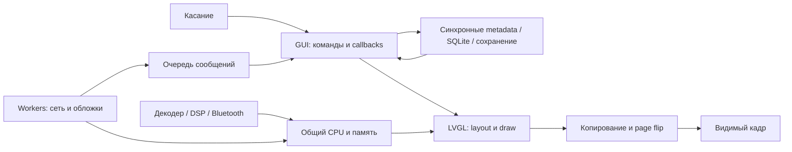

# Плавность, отзывчивость, стабильность и энергия Sonix / R1

26 октября 2026 · первый глубокий проход · [общая задача #110](https://forgejo.l.rekkod.com.ru/ai-workspace/ai-sonix-r1-backlog/issues/110) · метка **аудит: perf-2026-10-26**.

## Основной вывод

Новая жалоба относится к установленному текущему бинарнику, а не к старой сборке. В коде есть несколько независимых источников задержек. Наиболее близки к новому симптому движение через layout-свойства LVGL, синхронная подготовка снимка при Back и тяжёлая работа перед первым кадром/после отпускания обложки. Однако единственная корневая причина фактических лагов R1 пока не установлена: текущей покадровой трассы нет.

Более глубокая общая причина — **временная стоимость работы не закреплена на границах модулей**. Очередь ограничена числом сообщений, список — числом строк, история — числом записей, кэш — байтами. Ни один из этих лимитов сам по себе не гарантирует, что GUI быстро вернётся к касанию и кадру. Часть «асинхронных» путей лишь доставляет результат асинхронно, оставляя диск, сборку представления или отмену работы синхронными.

Три отказовых механизма подтверждены отдельными исполняемыми пробами на ПК: изменение приоритета GUI при отказе worker, отсутствие бюджета drain и потеря terminal callback с удержанием памяти. Их нельзя объявить причиной каждого пользовательского подтормаживания или редкого перезапуска.

## Границы и доказательства

- Исходники: `worktrees/sonix-download-stability`, HEAD `3e6a0b96db591464050aed8f9e1016ce1a16f5f3`, branch `fix/gesture-navigation`; до анализа рабочее дерево чистое.
- Read-only ADB подтвердил `/usr/bin/sonix_player`, SHA-256 `ee11d6528dde7dd7fce429e1afba0ddb573d19662a5a52c68f8f1f676a975049`. Это программа из образа `4fb00bba6fca7ca189ecef02f828fe328de08a536fadece06980f4e22b65c25b`.
- Текущий boot-ID `768833c0-1fbb-4772-b7b1-4f90ca06435e`. Пользователь устанавливал прошивку между проверками; отличие от прежнего boot-ID не является новым свидетельством аварийной перезагрузки.
- Читались действующие пути GUI/input/render, library/search/history, artwork/theme, streaming/network, audio/external PCM, power/storage/config/logging и сборочные флаги. Сверены существующий реестр и старые performance/architecture отчёты. Это покрытие основных сквозных путей, не доказательство исполнения всех ветвей прошивки.
- На устройстве в этом проходе только чтение идентичности, ограниченных настроек и `/proc`. Не переключались экраны/треки, не запускались новая программа, fault injection, перепрошивка, разрядный тест или PGO. Product code и зависимости не менялись.
- В `output/performance-audit-20261026/` находятся `run_fault_probes.py`, извлечённые C-пробы, `fault-probes.json`, снимки/карта задач. Пробы компилируются с `-Wall -Wextra -Werror`, используют точные выбранные production functions, mock filesystem/GUI и исполняются в одноразовых host-процессах. Они проверяют control flow, не MIPS timing.

### Что уже измерено и чего это не доказывает

| Данные | Фактический результат | Предел вывода |
|---|---|---|
| Прежняя matched-проверка, экран выключен, один FLAC/настройки, 3 окна по ~15 с | CPU baseline 5,52%, candidate 5,54%; пауза 1,19% / 1,05% | Нет найденного прироста средней нагрузки в этом коротком сценарии. Не frame-time и не доказательство статистической эквивалентности/автономности |
| После прежних жестов | ~0,99–1,08% CPU; RSS 21292 КиБ стабильно в 2×10 с | Не обнаружено постоянного render loop в том интервале; длинная утечка не исключена |
| Текущий спокойный read-only снимок | RSS 21344 КиБ; 29 потоков; VmLck 8364 КиБ; MemAvailable 21952 из MemTotal 58560 КиБ; zram swap занято 792 КиБ | Нет основания объявлять память исчерпанной. Один снимок не показывает пики/reclaim во время жеста |
| Текущие настройки | screen-off 30 с, brightness 38%, standby_mem=0; cached_render не задан, default=0 | Экран может погаснуть без MEM. Настройки не изменялись; отсутствие cpufreq-файлов в проверенном стандартном пути не доказывает фиксированную частоту SoC |
| Host forced worker failure | policy 0→5 (SCHED_OTHER→SCHED_IDLE), copy выполнен на caller, имя потока filesop | Подтверждён дефект ветви отказа; реальный R1 main сейчас sonix_player, эта ветвь не установлена причиной жалобы |
| Host callback repost | 10000 callbacks в одном drain, peak pending=1 при capacity32 | Подтверждено отсутствие time/count budget; не наблюдение такого трафика на устройстве |
| Host completion refusal | 2 mock-записи успешны, callback0, payload удержан | Подтверждён leak/потеря результата выбранного worker при отказе post |

Числа старого `docs/ai-handoff/PERF-1.3.0.md`, особенно host×14 и 8311 объектов/122 экрана, не переносились на текущую прошивку как свежие измерения. Старые #47/#43/#53 и прочие исправления учитываются как уже внесённые. #109 остаётся закрытой ограниченной CPU-проверкой; #108 повторно открыта после пользовательской проверки плавности.

## Цепочка задержки и общие причины

### 1. Новый путь движения усиливает цену существующего рендера

В `player.c:4601` каждый PRESSING пишет `translate_x` без проверки равенства. В реально использованном дереве LVGL 9.6.0 `lv_obj_style.c:433–468` setter всегда вызывает refresh; `lv_style.c:49` помечает TRANSLATE_X как LAYOUT_UPDATE и PARENT_LAYOUT_UPDATE. Обычные `lv_obj_set_x/y` уже сравнивают значения: утверждение «все setters одинаково дороги» неверно. Нулевая завершающая анимация и повторный стиль — конкретная возможность сократить ненужную работу, но не готовая оценка выигрыша.

Back создаёт `lv_snapshot_take` предыдущей страницы синхронно в момент захвата жеста; Home-preview создаёт другой снимок после удержания. Это разовая цена на границе жеста, а не обязательно цена каждого его кадра. Новый pull открывает полноценный плеер, перемещает обратно и на commit снова выполняет open. Все эти пути нужно разнести в трассе, а не лечить удлинением анимации.

Один полный 480×800 RGB565 кадр — 750 КиБ. При 60 кадрах/с только одна полная запись — около46 МБ/с, без чтения, blending и синхронизации второй страницы. Это арифметическая иллюстрация объёма, не measured bandwidth. Путь через cached RAM уже есть и должен сравниваться до создания нового renderer. См. #108, #111–112, #115, #117.

### 2. Виртуальное представление не делает источник данных неблокирующим

В обычных музыкальных списках есть пул, окно и отсрочка thumbnail/count работы при движении. Но наполнение окна, получение album/title и открытие индекса остаются синхронными; lock/storage latency попадает в GUI. В общем поиске локальные запросы запускаются до remote workers. При перелистывании трека перед return-анимацией выполняется команда, читаются metadata, обновляются общие представления и сохраняется очередь.

В отдельном файловом менеджере есть более простой дефект масштаба: он добавляет строки пачками, но не переиспользует их. Фоновый музыкальный browser и этот экран не следует путать. Минимальное направление — применять уже существующие механизмы, не писать третий список. См. #114–116, #118, #12.

### 3. Ограниченный объём не означает ограниченное время или надёжный итог

GUI drain может продлеваться собственными callbacks. История пишет до4 записей за poll, но одна транзакция может ждать I/O. Удаление устаревшего результата поиска по generation не прекращает его HTTP/DNS; последний запрос того же source ждёт прежний. У каждого cache есть предел, но одновременный переход может превысить комфортный общий memory footprint.

Завершение файловой операции/добавления в плейлист иногда существует лишь как сообщение, которое можно потерять. Отказ worker не должен переводить тяжёлую работу в UI: в текущем файловом fallback это ещё и меняет scheduler самого GUI. Корректный общий принцип — операция владеет результатом до принятия/утилизации, сообщение только будит получателя. См. #113, #116, #119–121, #124.

### 4. Жизненный цикл разбит между экранами, клиентами и power policy

Qobuz/Tidal/Subsonic сохраняют часть queue/prefetch orchestration в page-модулях. В частности, watcher Qobuz каждую секунду обновляет protect list до64 путей; library-backed и никогда не авторизованные случаи уже быстро отсекаются. Дешёвое объединение ticks возможно, но выигрыш сначала измеряется. Удалять все потоки ради меньшего числа строк в /proc бессмысленно: coverloader, logwriter, book writer и многие остальные ждут condition/event.

У coverloader выбор scheduling level стоит до ожидания; первая работа после изменения screen-state может выполняться с прежним выбором. Power policy отдельно решает needs_network, автоотключение и MEM. Связь Wi-Fi с BT содержит защиту общего SDIO, а не очевидно лишнюю зависимость. См. #24, #122, #125; #20/#103 — архитектурный вариант последующего прохода.

### 5. Редкий reboot, Bluetooth и UI jank нельзя слить в один диагноз

Новые гипотезы могут иметь общий ресурсный фон, но переход от корреляции к причине требует contemporaneous evidence. #34 (перезапуск), #10 (заикания), #99 (SDIO), #84 (session races) остаются отдельными. Исправленные BlueZ/LDAC ownership и resume mutex не объявляются сломанными повторно без нового подтверждения. Внешний PCM имеет отдельную неограниченную recovery-ветвь #123, которую обычный playback fix #47 не покрывает.

## Карта задач этого прохода

Метка находится только в отдельном Sonix/R1 реестре. Приоритет — порядок работы, а не утверждение, что гипотеза доказана. Новые карточки содержат набросок исправления, ограничения и acceptance; подробное проектирование остаётся вторым проходом.

| Задача | Приоритет | Предмет | Предварительный масштаб |
|---|---|---|---|
| [#111](https://forgejo.l.rekkod.com.ru/ai-workspace/ai-sonix-r1-backlog/issues/111) | P1 | Измерять задержку касания и кадра целиком, а не только средний CPU | средне; диагностические точки и повторяемый сценарий |
| [#112](https://forgejo.l.rekkod.com.ru/ai-workspace/ai-sonix-r1-backlog/issues/112) | P2 | Проверить отрисовку через кэшируемую RAM, площадь перерисовки и page flip | средне; крупно при изменении драйвера |
| [#113](https://forgejo.l.rekkod.com.ru/ai-workspace/ai-sonix-r1-backlog/issues/113) | P2 | Ограничить время обработки GUI-сообщений и исключить голодание ввода/кадра | средне; общий мост и контракт повторной доставки |
| [#114](https://forgejo.l.rekkod.com.ru/ai-workspace/ai-sonix-r1-backlog/issues/114) | P2 | Убрать ожидание индекса и холодные чтения карты из прокрутки и отправки поиска | средне–крупно; БД, поколения и представления |
| [#115](https://forgejo.l.rekkod.com.ru/ai-workspace/ai-sonix-r1-backlog/issues/115) | P2 | Разделить быстрый отклик на Next/открытие плеера и чтение метаданных | средне–крупно; граница команды, audio и now-playing |
| [#116](https://forgejo.l.rekkod.com.ru/ai-workspace/ai-sonix-r1-backlog/issues/116) | P2 | Сохранение истории, очереди и настроек не должно блокировать интерфейс | средне–крупно; согласовать durability и card lifetime |
| [#117](https://forgejo.l.rekkod.com.ru/ai-workspace/ai-sonix-r1-backlog/issues/117) | P2 | Развести смену палитры, монохромизацию и движение слоёв | средне; theme/artwork/gesture lifecycle |
| [#118](https://forgejo.l.rekkod.com.ru/ai-workspace/ai-sonix-r1-backlog/issues/118) | P2 | Файловый менеджер: ограничить число строк и холодную работу при входе в папку | средне; одна страница плюс модель чтения |
| [#119](https://forgejo.l.rekkod.com.ru/ai-workspace/ai-sonix-r1-backlog/issues/119) | P1 | При отказе рабочего потока не выполнять файловую операцию и не понижать приоритет GUI | точечно; обработка отказа и тест |
| [#120](https://forgejo.l.rekkod.com.ru/ai-workspace/ai-sonix-r1-backlog/issues/120) | P1 | Не терять завершения операций с плейлистами и файлами при полной очереди GUI | средне; 2 семейства workers и общий terminal contract |
| [#121](https://forgejo.l.rekkod.com.ru/ai-workspace/ai-sonix-r1-backlog/issues/121) | P2 | Сквозной deadline и отмена сетевых запросов: старый поиск не должен удерживать новый | крупно; общий сетевой контракт с поэтапной адаптацией |
| [#122](https://forgejo.l.rekkod.com.ru/ai-workspace/ai-sonix-r1-backlog/issues/122) | P2 | Актуализировать приоритет coverloader после ожидания и отбрасывать ненужную работу | точечно–средне; границы задания и отмены |
| [#123](https://forgejo.l.rekkod.com.ru/ai-workspace/ai-sonix-r1-backlog/issues/123) | P2 | Ограничить восстановление внешнего PCM при повторных EAGAIN/EPIPE | средне; звуковой ownership, высокий риск регрессии |
| [#124](https://forgejo.l.rekkod.com.ru/ai-workspace/ai-sonix-r1-backlog/issues/124) | P2 | Свести пиковую память изображений, страниц, поиска и zram в общий бюджет | средне диагностика; крупно общий resource ownership |
| [#125](https://forgejo.l.rekkod.com.ru/ai-workspace/ai-sonix-r1-backlog/issues/125) | P2 | Проверить реальную энергоэффективность и причины удержания бодрствования | средне; длительные сравнимые прогоны |
| [#126](https://forgejo.l.rekkod.com.ru/ai-workspace/ai-sonix-r1-backlog/issues/126) | P3 | Профилировать вертикальный просмотр альбомов и его покадровую проекцию | средне; optional viewer, ниже основных сценариев |
| [#127](https://forgejo.l.rekkod.com.ru/ai-workspace/ai-sonix-r1-backlog/issues/127) | P3 | Оценить code layout, LTO и профиль изменённых UI-модулей по фактической нагрузке | средне; дорогие сборки/обучение только в конце |
| [#128](https://forgejo.l.rekkod.com.ru/ai-workspace/ai-sonix-r1-backlog/issues/128) | P1 | Файловые операции должны сохранять владельца карты до последней записи и удаления | средне–крупно; data ownership и рекурсивные операции |

**Переиспользованные карточки:** #108 — движение (повторно открыта, P1); #10 — BT; #11 — A8; #12 — оставшаяся lazy-инициализация; #20 — крупный рефакторинг; #24 — activity/power; #34 — reboot; #47 — остаток resume-приёмки; #74 — rootfs budget; #84 — session races; #99 — SDIO; #103 — state/view contracts. В них добавлены метка и актуальный контекст. #109 помечена как историческое доказательство и остаётся закрыта.

Предложения #20/#103 не превращены в согласованную реализацию; новые возможности и игровые функции не продвигаются выше основных исправлений. #43 остаётся визуальной приёмкой уже внесённой клавиатуры; общий palette cost учитывается отдельно. Не добавлялись дубли OTA/RM01/новых сервисов: они не объясняют текущую плавность.

## Наброски по отдельным причинам

### METRICS — [#111](https://forgejo.l.rekkod.com.ru/ai-workspace/ai-sonix-r1-backlog/issues/111)

**Механизм.** Текущий perfstat считает CLOCK_THREAD_CPUTIME_ID; draw p95 исключает flush, хранит первые 1024 кадра, а CPU таймеров распределяет поровну между запущенными callbacks. Ожидание I/O, mutex, драйвера или CPU другим потоком может выглядеть дешёвым. Прошлые motion-тесты проверяли состояния и кадры, без длительностей кадров.

**Доказано / неизвестно.** Подтверждено кодом и составом прежних отчётов; пользователь сообщает лаги именно ee11/3e6a0b9. Предыдущая CPU/RSS-проверка #109 не измеряла плавность.

**Набросок.** Дополить существующую отключаемую диагностику монотонным временем: input→handler→layout/render→flush, интервалы кадров, время очередей/замков, faults и переключения. Ограниченный буфер в RAM, выгрузка на ПК; отдельно измерить overhead. Не новый постоянно работающий profiler.

**Проверка.** Сравнимые холодные/тёплые жесты и списки, local/stream/BT, долгие имена и палитры; p50/p95/p99/max, пропущенные интервалы и >100 мс stalls. Разделять CPU и elapsed; установить бюджет по реальному R1 и проверить выключенную диагностику.

**Опорный код:** [src/system/device/perfstat.c:50](https://github.com/Rekkod-Tree/sonix-player-rekkod-mod/blob/3e6a0b96db591464050aed8f9e1016ce1a16f5f3/sonix-player/src/system/device/perfstat.c#L50), [src/system/device/perfstat.c:231](https://github.com/Rekkod-Tree/sonix-player-rekkod-mod/blob/3e6a0b96db591464050aed8f9e1016ce1a16f5f3/sonix-player/src/system/device/perfstat.c#L231), [src/main.c:2627](https://github.com/Rekkod-Tree/sonix-player-rekkod-mod/blob/3e6a0b96db591464050aed8f9e1016ce1a16f5f3/sonix-player/src/main.c#L2627). Связи: [#108](https://forgejo.l.rekkod.com.ru/ai-workspace/ai-sonix-r1-backlog/issues/108), [#109](https://forgejo.l.rekkod.com.ru/ai-workspace/ai-sonix-r1-backlog/issues/109), [#52](https://forgejo.l.rekkod.com.ru/ai-workspace/ai-sonix-r1-backlog/issues/52).

### FRAMEBUFFER — [#112](https://forgejo.l.rekkod.com.ru/ai-workspace/ai-sonix-r1-backlog/issues/112)

**Механизм.** По умолчанию LVGL рисует непосредственно в mmap framebuffer; подготовленный cached_render включается только параметром. Комментарий платформы описывает uncached отображение. RAM-путь объединяет все повреждения в один bounding box и копирует задолженность двух страниц; движение большого слоя дорого в обоих путях.

**Доказано / неизвестно.** На текущем R1 параметра cached_render в device_config.ini нет: кодовый default=0. Потери времени в mmap/vsync сейчас не измерены. Полный RGB565-кадр 480×800 занимает 768000 байт; это расчёт, не benchmark шины.

**Набросок.** Сравнить уже существующие direct и cached_render на одинаковых сценариях. Разделить draw, копирование dirty regions и ioctl; проверить площадь под мини-плеером/движущимися слоями. При обосновании допустим узкий патч LVGL/драйвера; не включать тройной буфер или менять vsync вслепую.

**Проверка.** R1: frame-time и input latency до/после, нет tearing/старых областей, двойной буфер, rotate/wake/capture, +750 КиБ и общая память учтены. Не подменять native результат быстрым SDL.

**Опорный код:** [src/main.c:1360](https://github.com/Rekkod-Tree/sonix-player-rekkod-mod/blob/3e6a0b96db591464050aed8f9e1016ce1a16f5f3/sonix-player/src/main.c#L1360), [src/main.c:1466](https://github.com/Rekkod-Tree/sonix-player-rekkod-mod/blob/3e6a0b96db591464050aed8f9e1016ce1a16f5f3/sonix-player/src/main.c#L1466), [src/main.c:1584](https://github.com/Rekkod-Tree/sonix-player-rekkod-mod/blob/3e6a0b96db591464050aed8f9e1016ce1a16f5f3/sonix-player/src/main.c#L1584), [lv_conf.h:112](https://github.com/Rekkod-Tree/sonix-player-rekkod-mod/blob/3e6a0b96db591464050aed8f9e1016ce1a16f5f3/sonix-player/lv_conf.h#L112). Связи: [#108](https://forgejo.l.rekkod.com.ru/ai-workspace/ai-sonix-r1-backlog/issues/108), [#52](https://forgejo.l.rekkod.com.ru/ai-workspace/ai-sonix-r1-backlog/issues/52).

### GUI-BUDGET — [#113](https://forgejo.l.rekkod.com.ru/ai-workspace/ai-sonix-r1-backlog/issues/113)

**Механизм.** post_drain_cb крутится до пустоты; callbacks выполняются вне lock и могут снова публиковать работу. Слоты latest выбираются перед ring. Лимит 32 защищает память, но не длительность одного прохода и не справедливость.

**Доказано / неизвестно.** Probe gui-drain-budget на точных извлечённых функциях обработал 10000 callbacks за один drain при peak_pending=1. Это искусственное воспроизведение отсутствия бюджета, не доказательство потока из 10000 сообщений на R1.

**Набросок.** Ограниченный elapsed/count бюджет с сохранением doorbell для хвоста; справедливость latest/ring; отдельная надёжная доставка terminal results. Не блокировать аудио и не увеличивать очередь как единственное лечение.

**Проверка.** При постоянных producer/repost продолжаются ввод и кадры; terminal state не теряется, нет starvation и busy loop. Замерить максимум drain и задержку команд на R1, поведение screen-off и shutdown.

**Опорный код:** [src/gui/shell/gui.c:201](https://github.com/Rekkod-Tree/sonix-player-rekkod-mod/blob/3e6a0b96db591464050aed8f9e1016ce1a16f5f3/sonix-player/src/gui/shell/gui.c#L201), [src/gui/shell/gui.c:268](https://github.com/Rekkod-Tree/sonix-player-rekkod-mod/blob/3e6a0b96db591464050aed8f9e1016ce1a16f5f3/sonix-player/src/gui/shell/gui.c#L268), [src/main.c:2632](https://github.com/Rekkod-Tree/sonix-player-rekkod-mod/blob/3e6a0b96db591464050aed8f9e1016ce1a16f5f3/sonix-player/src/main.c#L2632). Связи: [#20](https://forgejo.l.rekkod.com.ru/ai-workspace/ai-sonix-r1-backlog/issues/20), [#103](https://forgejo.l.rekkod.com.ru/ai-workspace/ai-sonix-r1-backlog/issues/103).

### LIBRARY-IO — [#114](https://forgejo.l.rekkod.com.ru/ai-workspace/ai-sonix-r1-backlog/issues/114)

**Механизм.** Виртуализация ограничивает число виджетов, но row_at→window_cover синхронно читает окно SQLite под db_lock. Открытие индекса обходит rowids и считает A–Z; count_for создаёт индекс ради счётчика. Общий поиск до запуска remote jobs синхронно открывает три локальных индекса. Cache miss и чужая длинная транзакция остаются в GUI.

**Доказано / неизвестно.** Путь подтверждён статически; задержка на конкретной библиотеке не измерена. Пул строк, окно и отложенные thumbnails уже существуют, их не нужно создавать заново.

**Набросок.** Профиль db_lock/statement/I/O, дешёвые агрегаты вместо materialize для count, предзагрузка окна/снимки generation вне кадра. Индексы/statement reuse SQLite рассмотреть до замены БД; сохранить ownership карты и сортировку.

**Проверка.** Холодная/тёплая карта, большая библиотека, быстрый fling/A–Z и поиск при scan/save. Нет I/O-ожидания в обработке движения, устаревшие данные не попадают на новую карту; число/порядок/полнота выдачи сохранены.

**Опорный код:** [src/gui/library/medialist.c:681](https://github.com/Rekkod-Tree/sonix-player-rekkod-mod/blob/3e6a0b96db591464050aed8f9e1016ce1a16f5f3/sonix-player/src/gui/library/medialist.c#L681), [src/gui/library/medialist.c:1741](https://github.com/Rekkod-Tree/sonix-player-rekkod-mod/blob/3e6a0b96db591464050aed8f9e1016ce1a16f5f3/sonix-player/src/gui/library/medialist.c#L1741), [src/system/library/library.c:3753](https://github.com/Rekkod-Tree/sonix-player-rekkod-mod/blob/3e6a0b96db591464050aed8f9e1016ce1a16f5f3/sonix-player/src/system/library/library.c#L3753), [src/system/library/library.c:3962](https://github.com/Rekkod-Tree/sonix-player-rekkod-mod/blob/3e6a0b96db591464050aed8f9e1016ce1a16f5f3/sonix-player/src/system/library/library.c#L3962), [src/gui/library/searchall.c:489](https://github.com/Rekkod-Tree/sonix-player-rekkod-mod/blob/3e6a0b96db591464050aed8f9e1016ce1a16f5f3/sonix-player/src/gui/library/searchall.c#L489). Связи: [#103](https://forgejo.l.rekkod.com.ru/ai-workspace/ai-sonix-r1-backlog/issues/103), [#40](https://forgejo.l.rekkod.com.ru/ai-workspace/ai-sonix-r1-backlog/issues/40).

### TRACK-CRITICAL — [#115](https://forgejo.l.rekkod.com.ru/ai-workspace/ai-sonix-r1-backlog/issues/115)

**Механизм.** После отпускания обложки player_screen_next/prev выполняются до запуска завершающей анимации. load_and_play_at читает metadata и сохраняет очередь; refresh_now_playing обновляет много представлений. Открытие sheet вызывает upnext_update; тот читает library title, при промахе metadata_read, затем layout. Поэтому видимый отклик ждёт диск/модель, даже если сам draw быстрый.

**Доказано / неизвестно.** Порядок вызовов подтверждён кодом. Важные оптимизации metadata cache и streamed metadata до файла уже есть; нельзя вернуть числовые имена .m4a или проигрывание с неверным ReplayGain.

**Набросок.** Сначала лёгкое подтверждение принятой команды, затем подготовка и публикация согласованного snapshot по serial. Up-next брать из доступной модели/кэша; тяжёлое обновление только для изменённых частей. Не разнести queue и audible-current в независимые истины.

**Проверка.** Next/Prev, книга/подкаст, конец списка, restart текущего, быстрое переключение, lazy stream/offline. Обложка, название, источник и реальная очередь не расходятся; input→feedback и command→PCM измерены отдельно.

**Опорный код:** [src/gui/nowplaying/player.c:4681](https://github.com/Rekkod-Tree/sonix-player-rekkod-mod/blob/3e6a0b96db591464050aed8f9e1016ce1a16f5f3/sonix-player/src/gui/nowplaying/player.c#L4681), [src/system/playback/device_state.c:587](https://github.com/Rekkod-Tree/sonix-player-rekkod-mod/blob/3e6a0b96db591464050aed8f9e1016ce1a16f5f3/sonix-player/src/system/playback/device_state.c#L587), [src/gui/nowplaying/player.c:2494](https://github.com/Rekkod-Tree/sonix-player-rekkod-mod/blob/3e6a0b96db591464050aed8f9e1016ce1a16f5f3/sonix-player/src/gui/nowplaying/player.c#L2494), [src/gui/nowplaying/player.c:3895](https://github.com/Rekkod-Tree/sonix-player-rekkod-mod/blob/3e6a0b96db591464050aed8f9e1016ce1a16f5f3/sonix-player/src/gui/nowplaying/player.c#L3895), [src/gui/nowplaying/player.c:4779](https://github.com/Rekkod-Tree/sonix-player-rekkod-mod/blob/3e6a0b96db591464050aed8f9e1016ce1a16f5f3/sonix-player/src/gui/nowplaying/player.c#L4779). Связи: [#108](https://forgejo.l.rekkod.com.ru/ai-workspace/ai-sonix-r1-backlog/issues/108), [#47](https://forgejo.l.rekkod.com.ru/ai-workspace/ai-sonix-r1-backlog/issues/47), [#103](https://forgejo.l.rekkod.com.ru/ai-workspace/ai-sonix-r1-backlog/issues/103).

### PERSISTENCE — [#116](https://forgejo.l.rekkod.com.ru/ai-workspace/ai-sonix-r1-backlog/issues/116)

**Механизм.** playhistory_heard/poll вызывает flush_locked на GUI пути; FLUSH_BATCH=4 ограничивает записи, не время. library_history_record_at берёт db_lock и делает INSERT/DELETE/RELEASE. config_save синхронно пишет snapshot, fsync файла и каталога; queue_persist при изменённой файловой очереди дублирует все пути и сохраняет их. Защита данных правильная, место исполнения дорого.

**Доказано / неизвестно.** Подтверждён синхронный путь, не измерены миллисекунды задержки. История ограничена; это не проблема бесконечного роста. Book writer уже отдельный, повторно его выносить не требуется.

**Набросок.** Снимки/ревизии и bounded writer с объединением безопасных промежуточных состояний; важные terminal/выключение/USB требуют явного flush. Не отключать fsync, транзакции, идентичность карты и подтверждение успешной записи ради скорости.

**Проверка.** Медленная/полная/сменённая карта, пауза/Next, закрытие приложения, USB handoff и сбой записи; GUI не ждёт долгий fsync, подтверждённые данные сохраняются, pending память ограничена.

**Опорный код:** [src/system/playback/playhistory.c:83](https://github.com/Rekkod-Tree/sonix-player-rekkod-mod/blob/3e6a0b96db591464050aed8f9e1016ce1a16f5f3/sonix-player/src/system/playback/playhistory.c#L83), [src/gui/nowplaying/player.c:3096](https://github.com/Rekkod-Tree/sonix-player-rekkod-mod/blob/3e6a0b96db591464050aed8f9e1016ce1a16f5f3/sonix-player/src/gui/nowplaying/player.c#L3096), [src/system/library/library.c:2904](https://github.com/Rekkod-Tree/sonix-player-rekkod-mod/blob/3e6a0b96db591464050aed8f9e1016ce1a16f5f3/sonix-player/src/system/library/library.c#L2904), [src/system/core/config.c:301](https://github.com/Rekkod-Tree/sonix-player-rekkod-mod/blob/3e6a0b96db591464050aed8f9e1016ce1a16f5f3/sonix-player/src/system/core/config.c#L301), [src/system/playback/device_state.c:403](https://github.com/Rekkod-Tree/sonix-player-rekkod-mod/blob/3e6a0b96db591464050aed8f9e1016ce1a16f5f3/sonix-player/src/system/playback/device_state.c#L403). Связи: [#29](https://forgejo.l.rekkod.com.ru/ai-workspace/ai-sonix-r1-backlog/issues/29), [#40](https://forgejo.l.rekkod.com.ru/ai-workspace/ai-sonix-r1-backlog/issues/40), [#103](https://forgejo.l.rekkod.com.ru/ai-workspace/ai-sonix-r1-backlog/issues/103).

### ART-POLICY — [#117](https://forgejo.l.rekkod.com.ru/ai-workspace/ai-sonix-r1-backlog/issues/117)

**Механизм.** refresh_light уже делит callbacks по 6 на 15 мс, но лимит не измеряет их стоимость и обновляет скрытые страницы. sx_artview_refresh проходит все views; convert синхронно создаёт/пересчитывает RGB565 grayscale. При pull_begin сначала выполняется full open, затем sheet возвращается вниз; смена opaque/preparing policy может освобождать и снова создавать монохромные варианты в переходе.

**Доказано / неизвестно.** Тяжёлые ветви видны в коде; повторная конверсия при конкретной настройке — гипотеза до counters. Бюджет artview=3 МиБ, generation/refcount reuse и same-overlay guard уже есть.

**Набросок.** Разделить подготовку представления и фактическое open/opaque состояние; revision для скрытых цветов, time budget вместо только числа callbacks. Grayscale готовить/переиспользовать вне движения с сохранением общего лимита и lifetime.

**Проверка.** Graphite/LCD/Terminal, mono on/off, tint и динамическая обложка, coverless, cancel/reverse, поздний decode. Никаких неверных цветов/пикселей или роста RAM; проверить conversions и frame tail, не только snapshots.

**Опорный код:** [src/gui/shell/theme.c:371](https://github.com/Rekkod-Tree/sonix-player-rekkod-mod/blob/3e6a0b96db591464050aed8f9e1016ce1a16f5f3/sonix-player/src/gui/shell/theme.c#L371), [src/gui/shell/artview.c:158](https://github.com/Rekkod-Tree/sonix-player-rekkod-mod/blob/3e6a0b96db591464050aed8f9e1016ce1a16f5f3/sonix-player/src/gui/shell/artview.c#L158), [src/gui/shell/artview.c:353](https://github.com/Rekkod-Tree/sonix-player-rekkod-mod/blob/3e6a0b96db591464050aed8f9e1016ce1a16f5f3/sonix-player/src/gui/shell/artview.c#L353), [src/gui/nowplaying/player.c:3987](https://github.com/Rekkod-Tree/sonix-player-rekkod-mod/blob/3e6a0b96db591464050aed8f9e1016ce1a16f5f3/sonix-player/src/gui/nowplaying/player.c#L3987). Связи: [#108](https://forgejo.l.rekkod.com.ru/ai-workspace/ai-sonix-r1-backlog/issues/108), [#43](https://forgejo.l.rekkod.com.ru/ai-workspace/ai-sonix-r1-backlog/issues/43).

### FILES-LIST — [#118](https://forgejo.l.rekkod.com.ru/ai-workspace/ai-sonix-r1-backlog/issues/118)

**Механизм.** filespage rebuild синхронно read_folder→readdir/stat/strdup/qsort. rows_add добавляет по 14, но уже созданные строки не переиспользуются: за полный скролл остаются до MAX_ENTRIES=2000 виджетов. Это постепенное построение, не виртуальный пул; в музыкальном browser другой, уже фоновый reader.

**Доказано / неизвестно.** Механизм роста числа объектов подтверждён кодом; текущая RSS после 2000 строк не замерена. Не считать все списки прошивки невиртуализированными.

**Набросок.** Переиспользовать существующий пул/асинхронный folder reader с model ownership вместо второго самостоятельного движка. Поддержать picker папок, служебные файлы, сортировку и возврат; это отдельный узкий срез, не переписывание всей библиотеки.

**Проверка.** 14/500/2000 файлов, конец/начало, назад и смена карты; число UI-строк выходит на плато, cold entry отзывчив, menu/copy/move/picker работают, MAX_ENTRIES не снижать для маскировки затрат.

**Опорный код:** [src/gui/library/filespage.c:305](https://github.com/Rekkod-Tree/sonix-player-rekkod-mod/blob/3e6a0b96db591464050aed8f9e1016ce1a16f5f3/sonix-player/src/gui/library/filespage.c#L305), [src/gui/library/filespage.c:1075](https://github.com/Rekkod-Tree/sonix-player-rekkod-mod/blob/3e6a0b96db591464050aed8f9e1016ce1a16f5f3/sonix-player/src/gui/library/filespage.c#L1075), [src/gui/library/filespage.c:1120](https://github.com/Rekkod-Tree/sonix-player-rekkod-mod/blob/3e6a0b96db591464050aed8f9e1016ce1a16f5f3/sonix-player/src/gui/library/filespage.c#L1120), [src/gui/library/browser.c:1202](https://github.com/Rekkod-Tree/sonix-player-rekkod-mod/blob/3e6a0b96db591464050aed8f9e1016ce1a16f5f3/sonix-player/src/gui/library/browser.c#L1202). Связи: [#75](https://forgejo.l.rekkod.com.ru/ai-workspace/ai-sonix-r1-backlog/issues/75), [#12](https://forgejo.l.rekkod.com.ru/ai-workspace/ai-sonix-r1-backlog/issues/12).

### FILES-FALLBACK — [#119](https://forgejo.l.rekkod.com.ru/ai-workspace/ai-sonix-r1-backlog/issues/119)

**Механизм.** op_start при pthread_create!=0 вызывает op_worker прямо на вызывающем GUI-потоке. op_worker первым вызывает thread_be_background: GUI получает SCHED_IDLE (или nice19), затем делает рекурсивный copy/move. После возврата приоритет не восстанавливается. Это может давать устойчиво медленный UI после завершения операции.

**Доказано / неизвестно.** Host fault probe с точными production op_start/op_worker/thread_be_background и mock FS: policy SCHED_OTHER(0)→SCHED_IDLE(5), copy_calls=1 на caller, comm=filesop. На подключённом R1 main comm=sonix_player: текущий эпизод этим НЕ установлен.

**Набросок.** Fail-fast с корректным завершением состояния либо ограниченный существующий worker; запрет исполнения worker-функции на UI как fallback. Не заменять на бесконечное ожидание/перезапуск и не трогать файлы, если команда не принята.

**Проверка.** Forced EAGAIN/ENOMEM: GUI policy/nice не меняются, копирование не стартует скрыто, modal снимается, источник сохранён, повтор после снятия причины работает. Обычные copy/move/card guards проходят.

**Опорный код:** [src/gui/library/filespage.c:612](https://github.com/Rekkod-Tree/sonix-player-rekkod-mod/blob/3e6a0b96db591464050aed8f9e1016ce1a16f5f3/sonix-player/src/gui/library/filespage.c#L612), [src/gui/library/filespage.c:572](https://github.com/Rekkod-Tree/sonix-player-rekkod-mod/blob/3e6a0b96db591464050aed8f9e1016ce1a16f5f3/sonix-player/src/gui/library/filespage.c#L572), [src/system/core/utils.c:351](https://github.com/Rekkod-Tree/sonix-player-rekkod-mod/blob/3e6a0b96db591464050aed8f9e1016ce1a16f5f3/sonix-player/src/system/core/utils.c#L351). Связи: [#34](https://forgejo.l.rekkod.com.ru/ai-workspace/ai-sonix-r1-backlog/issues/34).

### COMPLETION — [#120](https://forgejo.l.rekkod.com.ru/ai-workspace/ai-sonix-r1-backlog/issues/120)

**Механизм.** batch_worker и fav_worker игнорируют false от gui_post; освобождение paths/batch и toast_busy_end есть только в callbacks. В filespage при отказе post лишь меняются op_ok/pending_op, но op_finished не снимает modal. Успешная запись может выглядеть зависшей, память остаётся занятой.

**Доказано / неизвестно.** Host probe точного batch_worker с успешными mock saves и refused gui_post: storage_successes=2, completion_calls=0, payload retained. Аналог fav/file подтверждён кодом; не заявляется native воспроизведение переполнения.

**Набросок.** Надёжный owned completion slot с явным disposal при shutdown, переиспользовать уже применённый подход gui_service_completions; разделить результат операции и best-effort toast. Просто gui_post_or_free уберёт утечку, но не восстановит итог/снятие busy.

**Проверка.** Очередь заполнена, экран закрыт, карта заменена, shutdown: результат применён ровно один раз либо безопасно уничтожен; busy/modal завершается, нет утечки и двойного освобождения. Повтор не дублирует уже успешную запись.

**Опорный код:** [src/gui/library/playlistpage.c:349](https://github.com/Rekkod-Tree/sonix-player-rekkod-mod/blob/3e6a0b96db591464050aed8f9e1016ce1a16f5f3/sonix-player/src/gui/library/playlistpage.c#L349), [src/gui/library/playlistpage.c:366](https://github.com/Rekkod-Tree/sonix-player-rekkod-mod/blob/3e6a0b96db591464050aed8f9e1016ce1a16f5f3/sonix-player/src/gui/library/playlistpage.c#L366), [src/gui/library/playlistpage.c:472](https://github.com/Rekkod-Tree/sonix-player-rekkod-mod/blob/3e6a0b96db591464050aed8f9e1016ce1a16f5f3/sonix-player/src/gui/library/playlistpage.c#L472), [src/gui/library/filespage.c:602](https://github.com/Rekkod-Tree/sonix-player-rekkod-mod/blob/3e6a0b96db591464050aed8f9e1016ce1a16f5f3/sonix-player/src/gui/library/filespage.c#L602), [src/gui/shell/gui.c:106](https://github.com/Rekkod-Tree/sonix-player-rekkod-mod/blob/3e6a0b96db591464050aed8f9e1016ce1a16f5f3/sonix-player/src/gui/shell/gui.c#L106). Связи: [#20](https://forgejo.l.rekkod.com.ru/ai-workspace/ai-sonix-r1-backlog/issues/20), [#103](https://forgejo.l.rekkod.com.ru/ai-workspace/ai-sonix-r1-backlog/issues/103).

### HTTP-CANCEL — [#121](https://forgejo.l.rekkod.com.ru/ai-workspace/ai-sonix-r1-backlog/issues/121)

**Механизм.** searchall отменяет generation/pending и фильтрует late results, но не прерывает выполняющийся socket request. По source один worker; новый запрос ждёт старый. http timeout применяется к операциям сокета и каждому redirect, а getaddrinfo выполняется до установки socket timeout. Это не общий deadline запроса; медленные порции могут продлевать работу.

**Доказано / неизвестно.** Контрактный разрыв подтверждён кодом; нет фактического замера зависшего DNS на R1. Независимость source workers, body cap 256 КиБ и pending coalescing уже есть и сохраняются.

**Набросок.** Единый monotonic deadline/cancel token для DNS/connect/TLS/headers/body/redirect и checkpoints парсинга; ограничить совместную сетевую работу UI/prefetch/download. Допустима замена HTTP/TLS реализации при доказанной выгоде и MIPS/rootfs совместимости; не плодить потоки для обхода старых.

**Проверка.** No network, slow DNS, drip response, redirects, смена query/source/session, сон/USB; новый запрос не ждёт полный старый бюджет, foreground audio не голодает, число workers/FD/RAM ограничено. Отмена download не уничтожает поддерживаемое resume.

**Опорный код:** [src/gui/library/searchall.c:115](https://github.com/Rekkod-Tree/sonix-player-rekkod-mod/blob/3e6a0b96db591464050aed8f9e1016ce1a16f5f3/sonix-player/src/gui/library/searchall.c#L115), [src/gui/library/searchall.c:391](https://github.com/Rekkod-Tree/sonix-player-rekkod-mod/blob/3e6a0b96db591464050aed8f9e1016ce1a16f5f3/sonix-player/src/gui/library/searchall.c#L391), [src/system/net/http.c:278](https://github.com/Rekkod-Tree/sonix-player-rekkod-mod/blob/3e6a0b96db591464050aed8f9e1016ce1a16f5f3/sonix-player/src/system/net/http.c#L278), [src/system/net/http.c:925](https://github.com/Rekkod-Tree/sonix-player-rekkod-mod/blob/3e6a0b96db591464050aed8f9e1016ce1a16f5f3/sonix-player/src/system/net/http.c#L925). Связи: [#84](https://forgejo.l.rekkod.com.ru/ai-workspace/ai-sonix-r1-backlog/issues/84), [#24](https://forgejo.l.rekkod.com.ru/ai-workspace/ai-sonix-r1-backlog/issues/24), [#14](https://forgejo.l.rekkod.com.ru/ai-workspace/ai-sonix-r1-backlog/issues/14).

### COVER-SCHED — [#122](https://forgejo.l.rekkod.com.ru/ai-workspace/ai-sonix-r1-backlog/issues/122)

**Механизм.** coverloader выбирает background level до pthread_cond_wait. Если экран сменил состояние во время сна, первая новая работа наследует прежний выбор до следующего оборота. Отмена/generation защищает применение результата, но выполняющийся decode всё равно может расходовать CPU. Списочные stream covers уже ограничены 48 slots и одним worker, скрытые пиксели освобождаются.

**Доказано / неизвестно.** Порядок priority→wait→job подтверждён кодом; на R1 влияние на first-cover/wake latency не измерено. Нельзя объявлять 29 потоков утечкой: большинство реально спят.

**Набросок.** Выбирать уровень после пробуждения по текущему состоянию/ценности job; отменять устаревшие дорогие этапы до decode/resize, совмещать одинаковые requests. Не конкурировать с PCM realtime и не запускать массовую предзагрузку картинок.

**Проверка.** Screen off→on и обратно на sleeping worker, быстрый Next, смена сервисов, слабая сеть; правильный scheduler на первом job, нет starvation/late images и лишних запросов, звук без новых underrun.

**Опорный код:** [src/gui/nowplaying/coverloader.c:142](https://github.com/Rekkod-Tree/sonix-player-rekkod-mod/blob/3e6a0b96db591464050aed8f9e1016ce1a16f5f3/sonix-player/src/gui/nowplaying/coverloader.c#L142), [src/gui/nowplaying/coverloader.c:160](https://github.com/Rekkod-Tree/sonix-player-rekkod-mod/blob/3e6a0b96db591464050aed8f9e1016ce1a16f5f3/sonix-player/src/gui/nowplaying/coverloader.c#L160), [src/gui/streaming/streamrowart.c:124](https://github.com/Rekkod-Tree/sonix-player-rekkod-mod/blob/3e6a0b96db591464050aed8f9e1016ce1a16f5f3/sonix-player/src/gui/streaming/streamrowart.c#L124), [src/system/core/utils.c:335](https://github.com/Rekkod-Tree/sonix-player-rekkod-mod/blob/3e6a0b96db591464050aed8f9e1016ce1a16f5f3/sonix-player/src/system/core/utils.c#L335). Связи: [#24](https://forgejo.l.rekkod.com.ru/ai-workspace/ai-sonix-r1-backlog/issues/24), [#10](https://forgejo.l.rekkod.com.ru/ai-workspace/ai-sonix-r1-backlog/issues/10).

### EXTERNAL-PCM — [#123](https://forgejo.l.rekkod.com.ru/ai-workspace/ai-sonix-r1-backlog/issues/123)

**Механизм.** audio_external_write при -ESTRPIPE крутит snd_pcm_resume до результата !=-EAGAIN с usleep100ms. Внутри этой ветви нет elapsed deadline/cancel; внешний external_lock держится до конца write, а audio_external_end ждёт тот же lock. Обычная ветвь wait_room имеет другой ограниченный путь, эта его обходит. Повторный -EPIPE также делает prepare→continue без общего no-progress deadline; при постоянном отказе эта ветвь может крутиться без паузы.

**Доказано / неизвестно.** Статический отказовый сценарий подтверждён; вечный EAGAIN на R1 не воспроизведён. Это внешние источники/приём, не доказанная причина A2DP stutter или reboot.

**Набросок.** Ограниченное cancelable recovery у владельца PCM, typed terminal failure и корректный stop/route change. Не держать lock, нужный для остановки, во время неопределённого driver wait; сохранение lifetime и single writer обязательно.

**Проверка.** Mock resume всегда EAGAIN, запоздалое восстановление, end/новый источник/suspend: stop завершается ограниченно, нет double-close/UAF и stale restart. Отдельно forced постоянный EPIPE/неуспешный prepare: нет CPU-loop. Затем доступные AirPlay/DLNA/receiver/USB пути.

**Опорный код:** [src/system/audio/audio.c:6302](https://github.com/Rekkod-Tree/sonix-player-rekkod-mod/blob/3e6a0b96db591464050aed8f9e1016ce1a16f5f3/sonix-player/src/system/audio/audio.c#L6302), [src/system/audio/audio.c:6337](https://github.com/Rekkod-Tree/sonix-player-rekkod-mod/blob/3e6a0b96db591464050aed8f9e1016ce1a16f5f3/sonix-player/src/system/audio/audio.c#L6337), [src/system/audio/audio.c:6357](https://github.com/Rekkod-Tree/sonix-player-rekkod-mod/blob/3e6a0b96db591464050aed8f9e1016ce1a16f5f3/sonix-player/src/system/audio/audio.c#L6357). Связи: [#47](https://forgejo.l.rekkod.com.ru/ai-workspace/ai-sonix-r1-backlog/issues/47), [#71](https://forgejo.l.rekkod.com.ru/ai-workspace/ai-sonix-r1-backlog/issues/71), [#24](https://forgejo.l.rekkod.com.ru/ai-workspace/ai-sonix-r1-backlog/issues/24).

### MEMORY-BUDGET — [#124](https://forgejo.l.rekkod.com.ru/ai-workspace/ai-sonix-r1-backlog/issues/124)

**Механизм.** Локальные лимиты независимы: artview до3МиБ, decode budget до8МиБ с guard, page snapshot750КиБ, optional cached framebuffer750КиБ, индексы/очереди, TLS/search stacks, glyph caches. Каждая часть bounded, но их сумма и переходные дубли не ограничены общим сценарием. mlock кода и oom_score_adj=-500 защищают приложение, но не устраняют reclaim/zram latency.

**Доказано / неизвестно.** Read-only R1: MemTotal58560KiB, MemAvailable21952KiB, RSS21344KiB, VmLck8364KiB, SwapFree23780 из24572KiB. Это один спокойный снимок, не OOM/утечка и не пик. Минимальный MemFree нельзя интерпретировать отдельно от file cache.

**Набросок.** Инвентаризация owner/lifetime/peak, ограниченное удержание полезных вариантов, прежде всего убрать лишние дубли и неактуальные работы. Измерить malloc/faults/reclaim/zram/FD при worst useful combination; defer #12 и composition #104 оценить после этого.

**Проверка.** Длинные циклы scroll/open/close/search/next, большая очередь и concurrent audio/download; RSS/объекты/FD выходят на плато, нет monotonic leak, пиковые allocations не вызывают длинного reclaim. Не снижать поддерживаемое количество треков или качество обложек молча.

**Опорный код:** [src/gui/shell/artview.h:8](https://github.com/Rekkod-Tree/sonix-player-rekkod-mod/blob/3e6a0b96db591464050aed8f9e1016ce1a16f5f3/sonix-player/src/gui/shell/artview.h#L8), [src/gui/nowplaying/cover.c:98](https://github.com/Rekkod-Tree/sonix-player-rekkod-mod/blob/3e6a0b96db591464050aed8f9e1016ce1a16f5f3/sonix-player/src/gui/nowplaying/cover.c#L98), [src/main.c:562](https://github.com/Rekkod-Tree/sonix-player-rekkod-mod/blob/3e6a0b96db591464050aed8f9e1016ce1a16f5f3/sonix-player/src/main.c#L562), [src/gui/library/searchall.c:440](https://github.com/Rekkod-Tree/sonix-player-rekkod-mod/blob/3e6a0b96db591464050aed8f9e1016ce1a16f5f3/sonix-player/src/gui/library/searchall.c#L440). Связи: [#12](https://forgejo.l.rekkod.com.ru/ai-workspace/ai-sonix-r1-backlog/issues/12), [#74](https://forgejo.l.rekkod.com.ru/ai-workspace/ai-sonix-r1-backlog/issues/74), [#104](https://forgejo.l.rekkod.com.ru/ai-workspace/ai-sonix-r1-backlog/issues/104), [#34](https://forgejo.l.rekkod.com.ru/ai-workspace/ai-sonix-r1-backlog/issues/34).

### ENERGY — [#125](https://forgejo.l.rekkod.com.ru/ai-workspace/ai-sonix-r1-backlog/issues/125)

**Механизм.** Короткий средний CPU screen-off не измеряет radio residency, panel duty, фоновые запросы, zram и wakeups. В текущем пользовательском config standby_mem=0, screen_off_seconds=30, brightness38: гашение экрана не означает MEM. power.c различает network/activity вручную; Wi-Fi также удерживается BT ради безопасной общей SDIO последовательности.

**Доказано / неизвестно.** #109 остаётся честно закрытым только как короткое CPU/RSS-сравнение. В этой проверке настройки не менялись; автономность не измерена. Пауза stream считается active пока не STOPPED; польза/вред grace зависит от ожидания быстрого resume.

**Набросок.** Сопоставимые сценарии wired/BT/stream/pause, screen-on/off, с одинаковой яркостью/DSP/radios и известным питанием; attribution wakeups/requests/locks. Объединять ненужные ticks и release activity по #24, не отключать радио под активным stream/BT и не менять батарейные напряжения.

**Проверка.** Нормальная USE без подробных SD логов; CPU всех служб, wakeups, sleep/wake latency и отдельный контролируемый разряд. Реальный мА/Wh только при валидном измерителе, зарядный ток USB не расход; не объявлять экономию по одной цифре процента.

**Опорный код:** [src/system/device/power.c:632](https://github.com/Rekkod-Tree/sonix-player-rekkod-mod/blob/3e6a0b96db591464050aed8f9e1016ce1a16f5f3/sonix-player/src/system/device/power.c#L632), [src/system/device/power.c:712](https://github.com/Rekkod-Tree/sonix-player-rekkod-mod/blob/3e6a0b96db591464050aed8f9e1016ce1a16f5f3/sonix-player/src/system/device/power.c#L712), [src/system/device/power.c:748](https://github.com/Rekkod-Tree/sonix-player-rekkod-mod/blob/3e6a0b96db591464050aed8f9e1016ce1a16f5f3/sonix-player/src/system/device/power.c#L748), [src/main.c:2613](https://github.com/Rekkod-Tree/sonix-player-rekkod-mod/blob/3e6a0b96db591464050aed8f9e1016ce1a16f5f3/sonix-player/src/main.c#L2613). Связи: [#24](https://forgejo.l.rekkod.com.ru/ai-workspace/ai-sonix-r1-backlog/issues/24), [#109](https://forgejo.l.rekkod.com.ru/ai-workspace/ai-sonix-r1-backlog/issues/109), [#10](https://forgejo.l.rekkod.com.ru/ai-workspace/ai-sonix-r1-backlog/issues/10).

### COVERFLOW — [#126](https://forgejo.l.rekkod.com.ru/ai-workspace/ai-sonix-r1-backlog/issues/126)

**Механизм.** coverflow scroll_set→relayout→slot_bind заново рассчитывает проекцию движущихся картинок; trapezoid resampling/shading и glow выполняются на CPU. Число slots ограничено, static faces reuse есть, но bounded per-frame работа всё ещё может не помещаться в бюджет MIPS.

**Доказано / неизвестно.** Тяжёлый алгоритм подтверждён кодом, доля кадра не замерена. Viewer теперь открывается явно и освобождает buffers при закрытии: это не постоянный фон и не причина любого списка.

**Набросок.** Измерить project/draw/blur отдельно; рассмотреть quantized cached projections/дешевле геометрию при сохранении читаемости. Альтернатива более простой дизайн только после сравнения и визуального согласования, не удалять обычные обложки.

**Проверка.** Fling/drag/cancel, cold cover/placeholder, long title, mono и тёплый cache; CPU/frame и память до/после, hidden timer paused/buffers released. Не переносить сложность в постоянный cache без лимита.

**Опорный код:** [src/gui/nowplaying/coverflow.c:350](https://github.com/Rekkod-Tree/sonix-player-rekkod-mod/blob/3e6a0b96db591464050aed8f9e1016ce1a16f5f3/sonix-player/src/gui/nowplaying/coverflow.c#L350), [src/gui/nowplaying/coverflow.c:991](https://github.com/Rekkod-Tree/sonix-player-rekkod-mod/blob/3e6a0b96db591464050aed8f9e1016ce1a16f5f3/sonix-player/src/gui/nowplaying/coverflow.c#L991), [src/gui/nowplaying/coverflow.c:1035](https://github.com/Rekkod-Tree/sonix-player-rekkod-mod/blob/3e6a0b96db591464050aed8f9e1016ce1a16f5f3/sonix-player/src/gui/nowplaying/coverflow.c#L1035). Связи: [#108](https://forgejo.l.rekkod.com.ru/ai-workspace/ai-sonix-r1-backlog/issues/108).

### BUILD-CODEGEN — [#127](https://forgejo.l.rekkod.com.ru/ai-workspace/ai-sonix-r1-backlog/issues/127)

**Механизм.** LTO включён, hot O3/cold O2 сохранены. Последняя сборка использует прежний совместимый PGO, 12 изменённых единиц явно без профиля. Это исключает неправильное применение старых счётчиков, но не гарантирует прежний layout/горячий путь. Размер ELF, instruction cache и VmLck важны на MIPS.

**Доказано / неизвестно.** Manifest target-build-motion-release и предыдущие receipts проверены; потеря LTO не обнаружена. Утрата PGO на12 файлах сама по себе не установлена причиной лагов.

**Набросок.** Сначала убрать подтверждённые блокировки/лишнюю работу, затем одна сопоставимая codegen-проверка и обучение отшлифованного состава, если оправдано. Патчи/обновление toolchain и библиотек допустимы отдельно, с ABI/MIPS/size и workload доказательством; не включать fast-math ради UI.

**Проверка.** Сохраняются строгие profile mismatch/ABI проверки; сравнить normal USE CPU, frame tail, startup, размер/VmLck и численную корректность звука. GEN-инструментированный расход не сравнивать с normal USE.

**Опорный код:** [Makefile:122](https://github.com/Rekkod-Tree/sonix-player-rekkod-mod/blob/3e6a0b96db591464050aed8f9e1016ce1a16f5f3/sonix-player/Makefile#L122), [Makefile:180](https://github.com/Rekkod-Tree/sonix-player-rekkod-mod/blob/3e6a0b96db591464050aed8f9e1016ce1a16f5f3/sonix-player/Makefile#L180), [Makefile:202](https://github.com/Rekkod-Tree/sonix-player-rekkod-mod/blob/3e6a0b96db591464050aed8f9e1016ce1a16f5f3/sonix-player/Makefile#L202), [Makefile:468](https://github.com/Rekkod-Tree/sonix-player-rekkod-mod/blob/3e6a0b96db591464050aed8f9e1016ce1a16f5f3/sonix-player/Makefile#L468). Связи: [#97](https://forgejo.l.rekkod.com.ru/ai-workspace/ai-sonix-r1-backlog/issues/97), [#74](https://forgejo.l.rekkod.com.ru/ai-workspace/ai-sonix-r1-backlog/issues/74).

### FILES-CARD-OWNER — [#128](https://forgejo.l.rekkod.com.ru/ai-workspace/ai-sonix-r1-backlog/issues/128)

**Механизм.** filespage copy_file/copy_tree и op_worker используют абсолютные op_source/op_target с fopen/mkdir/rename/unlink; ожидаемый storage_card_token и pinned dirfd не передаются. Открытый FD мешает штатному umount, но не задаёт владение в промежутках между открытиями/после физического исчезновения карты. Общая защита download jobs из #29 этот отдельный путь не покрывает.

**Доказано / неизвестно.** Отсутствие участия файлового worker в existing card-token/pin API подтверждено статическим проходом; фактическая запись на другую карту или потеря файлов НЕ воспроизведены. На реальном носителе аварийные тесты не запускались.

**Набросок.** Закрепить идентичность/права источника и назначения при принятии команды, использовать существующий card gate/pinned directory; остановить новые side effects при отзыве. Cleanup/remove тоже принадлежат исходной карте. Сохранить обычное безопасное unmount и запрет записи при USB; никаких forced unmount.

**Проверка.** Изолированная модель двух карт/подмена mount identity между tree_bytes и copy, между файлами, перед cleanup/remove; на новом носителе нет записей/удалений от старой операции, источник не удалён после неполного copy. Штатные move/copy и USB должны завершаться предсказуемо.

**Опорный код:** [src/gui/library/filespage.c:443](https://github.com/Rekkod-Tree/sonix-player-rekkod-mod/blob/3e6a0b96db591464050aed8f9e1016ce1a16f5f3/sonix-player/src/gui/library/filespage.c#L443), [src/gui/library/filespage.c:488](https://github.com/Rekkod-Tree/sonix-player-rekkod-mod/blob/3e6a0b96db591464050aed8f9e1016ce1a16f5f3/sonix-player/src/gui/library/filespage.c#L488), [src/gui/library/filespage.c:572](https://github.com/Rekkod-Tree/sonix-player-rekkod-mod/blob/3e6a0b96db591464050aed8f9e1016ce1a16f5f3/sonix-player/src/gui/library/filespage.c#L572), [src/system/device/system.c:1064](https://github.com/Rekkod-Tree/sonix-player-rekkod-mod/blob/3e6a0b96db591464050aed8f9e1016ce1a16f5f3/sonix-player/src/system/device/system.c#L1064). Связи: [#29](https://forgejo.l.rekkod.com.ru/ai-workspace/ai-sonix-r1-backlog/issues/29), [#119](https://forgejo.l.rekkod.com.ru/ai-workspace/ai-sonix-r1-backlog/issues/119), [#120](https://forgejo.l.rekkod.com.ru/ai-workspace/ai-sonix-r1-backlog/issues/120), [#24](https://forgejo.l.rekkod.com.ru/ai-workspace/ai-sonix-r1-backlog/issues/24).

## Что сохранить из уже работающей оптимизации

- LTO и hot-O3/cold-O2; строгую совместимость старого PGO и glibc2.22. Число unprofiled UI-единиц не доказывает деградацию и не повод обучать вместо исправления блокировок.
- Eventfd/poll для GUI, event touch, парковку refresh/animation при выключенном экране, condition wait в паузе audio и sleeping workers.
- Пулы музыкальных/сервисных списков, compact index вместо копии всей библиотеки, ограниченные previews и один running+один pending query на source.
- Асинхронные decode и source identity обложки, scaled JPEG/PNG, memory guards, bounded artwork и отказ от массовой предзагрузки.
- Shared styles и equality helpers, разбивку light-theme callbacks, blur hold при движении, минимальные redraw там, где они уже сделаны.
- Один владелец PCM/очереди, безопасные serial отмены reopen, card-token guards, транзакции, атомарные config saves, ограниченный logwriter и history retention.

Ни отказ от шрифта макета, ни уменьшение лимита плейлистов, ни удаление обложек, ни отключение fsync или recovery/card guards не принимаются за оптимизацию без потери функций.

## Зависимости и архитектурные варианты

Обновлять, менять или дописывать библиотеки допустимо по новому указанию пользователя. Это расширяет варианты, но не доказывает полезность любого обновления.

| Область | Сначала проверить | Когда оправдана более крупная замена/правка | Что обязательно сохранить |
|---|---|---|---|
| LVGL / framebuffer | style churn, layout, dirty regions, cached RAM, flush timing | Нужный дешёвый путь отсутствует/дефект внутри библиотеки подтверждён | Геометрия/шрифт, input capture, palettes, rotate/wake, память R1, R3 отдельно |
| FreeType / glyph / icons | misses, реально связанные ресурсы, пилот A8 #11 | Формат/кэш или rasterizer доминирует после устранения I/O | Те же шрифты/языки/сглаживание; byte savings не равны CPU savings |
| SQLite | индексы, statement reuse, lock scopes, IO ownership | Предел остаётся после разделения читаемой модели и записи | Данные/история/очередь, migration/rollback, card identity |
| HTTP / TLS / resolver | полный deadline, cancel, limits и reuse | Существующий backend не позволяет bounded cancel или слишком дорог | Auth, trust/проверка сертификатов, redirects, streaming/resume, RAM/rootfs |
| ALSA / BlueALSA / LDAC / DSP | PCM starvation vs RF, actual buffers, lock/timeout, форматные копии | Есть точный upstream fix или измеряемый более дешёвый эквивалент | Sample format/rate/DoP, качество DSP, reconnect/volume/sleep; численные тесты и реальные выходы |
| Kernel / SDIO / power | версия всего комплекта, реальные retry/idle/IRQ | Причина ниже userspace подтверждена | Питание, suspend, карта/USB, stock-base compatibility; не менять зарядное напряжение ради perf |

Архитектурные варианты второго прохода:

1. **Точечный:** budget/equality/failure completion, async I/O в самых тяжёлых точках. Небольшая зона риска, быстрое измерение эффекта; оставляет повторение patterns в сервисах.
2. **Поэтапный фундамент:** owner состояния и job lifecycle, typed outcomes, bounded delivery/cancel, shared activity snapshot, затем service controllers и выбор состава. Дороже, но системно уменьшает связность и повторение найденных ошибок. Начать с одного вертикального среза.
3. **Замена ядра UI/хранилища/сервисного framework:** сейчас не обоснована как быстрый способ устранить жалобу. Может обсуждаться отдельно, если 1–2 не дают нужный бюджет; цена включает повторную приёмку всех сценариев, migration/ABI/OTA и поддержку.

Масштаб «точечно / средне / крупно» в карточках — предварительная сложность зависимости и приёмки, не обещание дней. Во втором проходе оценить альтернативы с уже измеренными hotspot и определить последовательность; не внедрять крупный framework только ради красивой схемы. Единая очередь, audio ownership и существующие UI-компоненты остаются ценными опорами.

## Предлагаемый порядок второго прохода

1. **Сначала воспроизводимость:** #111, exact baseline, trace source и 10+ повторений ключевого жеста, холодный/тёплый отдельно. Обычная USE; диагностический overhead измерить и выключать. Пороги устанавливаются по panel/frame budget, не по скорости ПК.
2. **Быстрые причины текущего jank:** #108, #112, #115/#117; один изменённый фактор за сравнение. Не лечить дополнительным ожиданием или произвольным замедлением всех анимаций.
3. **Защита от деградации/данных:** #119/#120/#128 и существующий #34; failure injection только на изолированных данных. Эти исправления ценны даже если не воспроизведён текущий скролл-лаг.
4. **Время на сквозных границах:** #113/#114/#116/#121/#123. Сопоставить быстрые исправления и общий контракт, чтобы не городить независимые ad-hoc механизмы.
5. **Совокупные ресурсы:** #124/#125/#122, #24/#12 и звуковые #10/#47/#99. Включить concurrent audio + scroll + cover + search/download.
6. **Вторичные выигрыши:** #11/#126 и затем #127. PGO/новая зависимость оцениваются после отладки, не маскируют I/O и ownership дефекты.

### Приёмочная матрица, которую нужно конкретизировать

- Motion: mini tap/pull/cancel, Back обычный/Home dwell, cover Next/Prev, page slide, list drag/fling/A–Z, длинные имена, chapter/queue; без и с поздней обложкой.
- Данные: небольшая/большая библиотека и файловая папка, cold/warm, scan/save конкурируют с GUI, large playlist, slow/full/read-only/removed card в изолированном стенде.
- Сеть: один/все/часть сервисов, offline/DNS/slow response/redirect, быстрая смена запросов/сервиса/аккаунта, загрузка и prefetch. Поиск не теряет источник и последние запросы.
- Выходы: jack, доступные BT-кодеки/ABR, внешний приём, USB-ЦАП при наличии; wired/stream/BT при активном интерфейсе, pause/resume/route/error. Непроверенные выходы перечисляются явно.
- Ресурсы: холодный boot и повторный вход, peak/plateau RSS и heap, FD/threads, page faults/zram, wakeups и CPU всех связанных служб. Повторные функциональные изменения состояния не принимать за утечку автоматически.
- Энергия: одинаковые brightness/radios/DSP/audio, screen-on/off и pause; отдельный валидный разряд, а не USB charge current. MEM=off/on — разные сценарии с явной фиксацией.

Для плавности собирать p50/p95/p99/max **elapsed** frame/input, число >100мс pauses, интервалы показа и dropped deadlines, отдельно build/layout/draw/flush. Период16мс в конфиге — намерение, не доказанные60fps. Даже если более ровный30fps окажется разумнее для отдельного эффекта, это отдельное обоснованное решение после замеров, а не тихое снижение всей отзывчивости.

## Результат первого прохода

Подготовлены корневые связи, 18 новых предметных карточек и общая #110; 13 существующих карточек получили метку/актуализацию, из них #108 снова открыта, #109 сохранена как ограниченный исторический результат. Все имеют степень уверенности или явно обозначенную проверку; номера не пересекаются с другими проектами. Подробные реализации, новая прошивка и обучение в этом проходе не выполнялись. Главный оставшийся пробел — native временная трасса самого пользовательского лагания.
