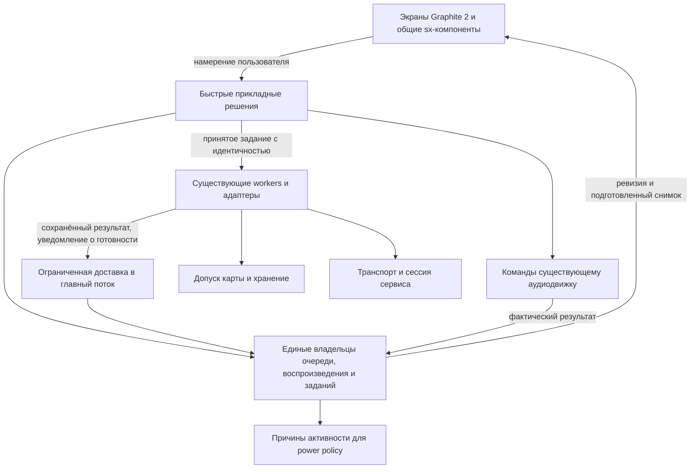

# Комплексное решение проблем плавности и устойчивости Sonix / R1

26.10.2026. Второй аналитический проход: варианты, рекомендуемые границы и порядок работ.
Основание: [аудит](PERFORMANCE_AUDIT_2026-10-26.md), исходники `3e6a0b9`,
[карта задач №110](https://forgejo.l.rekkod.com.ru/ai-workspace/ai-sonix-r1-backlog/issues/110).
Метка: `аудит: perf-2026-10-26`.

**Рекомендация:** выбрать вариант B поэтапно. Сначала его ограниченная часть B1:
исправления движения и отказов плюс общие правила времени выполнения, завершения
операций, снимков данных и доступа к карте. Затем B2: перенос сервисных
контроллеров и дальнейшая модульность там, где стоимость оправдана.
Обновления библиотек — отдельные сравнимые эксперименты внутри этого пути.

Это проект решения для обсуждения. Код, зависимости и настройки устройства в этом
проходе не менялись. Точные native frame-time и причина редкого reboot ещё неизвестны.
Наличие системного плана не превращает гипотезы аудита в доказанные причины.

## 1. Варианты и их цена

| Вариант | Что меняем | Ожидаемая польза | Стоимость и риск | Ограничение |
|---|---|---|---|---|
| A. Согласованные точечные исправления | Движение, drain, проблемные I/O-вызовы, completion/fallback, card ownership; каждый модуль сохраняет свой lifecycle | Быстрее получить улучшение конкретных сценариев, устранить подтверждённые отказовые дефекты | Наименьшая первоначальная стоимость; меньше одновременно изменяемых связей | Общие правила остаются распределёнными. Новые функции могут снова обойти их; требуется повторный аудит каждого клиента |
| B1. Общие правила исполнения и ресурсов | Всё полезное из A, плюс одинаковый контракт операции/результата/отмены, ограниченный UI-проход, подготовленные данные для кадра и единый смысл активности | Более предсказуемая отзывчивость и ошибки; повторное использование исправлений; меньше лишней работы | Средняя: несколько общих границ и последовательная адаптация потребителей; стоимость выше A, но изменения принимаются отдельно | Сам по себе контракт не ускоряет декодер, framebuffer или драйвер. Дорогие участки всё равно измеряются и оптимизируются |
| B2. Поэтапная модульная архитектура | Поверх B1: orchestration сервисов вне page, разделение view/model, регистрация возможностей и состава сборки | Проще поддерживать, добавлять/исключать сервисы, тестировать без UI; возможны меньшие cold footprint и фон | Высокая суммарная стоимость, распределённая по одному сервису/срезу. Нужна проверка фонового воспроизведения, очереди и сна | Изоляция модулей в одном процессе не защищает от всех ошибок памяти; проценты ускорения не следуют из структуры каталогов |
| C. Значительная замена основы | Новый renderer/UI-стек, транспорт или большая часть приложения вместо адаптации текущих механизмов | Может устранить доказанный предел конкретной основы; потенциально сильнее сократить сложность отдельных подсистем | Самая высокая цена переноса и приёмки; сложнее отделить причины регрессий | Сейчас нет замеров, доказывающих необходимость замены всего UI/приложения. Смена стека не исправит сама по себе владение данными и жизненный цикл |

B1 является законченным полезным объёмом для выпуска; B2 не обязан задерживать его.
A допустим при жёстком сроке: применять общие исправления в существующих компонентах,
но не размножать новые локальные обходы. C стоит выбирать для отдельной подсистемы,
если измеренный выигрыш или снижение сложности перекрывает цену миграции.

### Ожидаемый эффект по целям

| Цель | Что реально создаёт выигрыш | Что может ухудшиться и как ограничить |
|---|---|---|
| Плавность | Меньше layout/draw/копирования на кадр; никакого дискового ожидания в движении; ограниченная доставка событий | Новый bitmap cache может вытеснить полезные страницы; сравниваем peak RAM и frame tails |
| Отзывчивость | Быстрый приём команды и визуальный feedback, подготовка данных отдельно | Асинхронность не ускоряет сам диск; foreground read не должен ждать всей фоновой очереди |
| Стабильность | Владелец terminal result, безопасный отказ, идентичность карты/сессии, ограниченное восстановление | Новые гонки на границах; проверяем поздние результаты, повторные команды и отказ памяти |
| Энергия | Прекращение устаревших запросов, отсутствие бесполезных таймеров/перерисовки, корректное освобождение radio/activity | Слишком раннее освобождение приводит к дорогим reconnect/decode. Нужны grace и сравнимый разряд |
| Память/образ | Пулы, bounded cache, устранение дубликатов, затем lazy и состав модулей | Снимки, writer queues и новые библиотеки тоже занимают память/раздел. Считать сумму, не отдельный лимит |
| Поддержка | Один контракт команды/результата, понятный владелец, сценарные тесты | Избыточная универсальность добавит код и стоимость трассировки. Общий механизм выделяется по доказанному повторению |

Проценты ускорения, автономности и календарные сроки пока не оценены надёжно.
Ниже стоимость выражена затрагиваемыми границами и объёмом приёмки; дни следует
оценить после выбора варианта и первого native профиля.

## 2. Целевая схема B: роли и исполнение

Логические границы не требуют отдельного потока или процесса для каждого слоя.
Главный поток сохраняет LVGL, навигацию и быстрые решения над единой очередью.
Аудиопоток сохраняет PCM/декодирование/DSP. I/O и дорогая подготовка выполняются
существующими специализированными работниками; новые нужны только при доказанной
блокировке независимых классов работ.

Существующие `playlist`, `device_state`, `audiobookdb`, `playhistory`, `sx_*`,
`svclist`, `provider`, `search_source`, `streamturn` и card-token API сохраняются.
Общая схема объектов уже описана в [целевой архитектуре](REFACTORING_DESIGN_2026-10-26.md).
Этот документ добавляет к ней временные ограничения и правила ресурсов.

### Основные инварианты

1. **Кадр читает готовые данные.** Обработчик движения меняет только геометрию и
   состояние жеста. Он не открывает файл, не сканирует БД, не ждёт сеть/worker.
2. **Принятая команда имеет владельца.** Места для задания и обязательного результата
   резервируются до запуска. Если ресурса нет, команда явно не принята; тяжёлая
   работа не переносится в вызывающий UI-поток.
3. **Результат переживает потерю уведомления.** Он хранится у операции до принятия
   владельцем состояния или безопасной утилизации. Toast и страница его не владеют.
4. **Один факт — один владелец.** Запрошенный трек, фактически звучащий трек и место
   просмотра различаются. Мини-плеер и полный плеер не заводят отдельную очередь.
5. **Отмена имеет два эффекта:** немедленно отзывает право применить устаревший
   результат и прекращает оставшуюся работу в поддерживаемых безопасных точках.
6. **Права карты не обновляются автоматически.** Задание со старым token не получает
   новую карту по совпавшему пути. Это относится также к rename, cleanup и удалению.
7. **Закрытая страница и неактивный сервис — разные состояния.** Звук и заказанное
   сохранение могут продолжаться, виджеты и декоративные обновления паркуются.
8. **Бюджет памяти и времени учитывает совместную работу.** Звук, загрузка,
   поиск и оформление не получают каждый независимо всю свободную память/CPU.

## 3. Практические контракты B1

### B1.1. Кадр, ввод и очередь сообщений — #108, #111–113, #117

Сначала дополняется отключаемая диагностика: monotonic elapsed на границах
input/dispatch/layout/draw/flush, длительность ожиданий, объём dirty regions и
задержки доставки. CPU-time остаётся отдельной метрикой. В штатном режиме новые
подробные логи не пишутся постоянно на SD.

Для GUI вводятся правила:

- Доставка обычных callbacks имеет бюджет времени и количества. Когда он истёк,
  хвост остаётся готовым к обработке, но следующая порция не вытесняет ввод и кадр.
  Состояние eventfd/таймера нельзя очистить так, чтобы оставшийся хвост уснул навсегда.
- Важные завершения обслуживаются с гарантией продвижения, но их применение тоже
  короткое. Долгое построение результатов разбивается; один тяжёлый callback не
  становится допустимым только потому, что очередь имеет бюджет.
- Обновления уровня/прогресса/снимка объединяются по владельцу. Команды Next,
  добавления в очередь и сохранения данных не отбрасываются как «старый прогресс».
- Справедливость latest/обычной очереди проверяется при непрерывных producer.
  На пустой системе сохраняется event-driven ожидание без нового активного опроса.

Движение обложки/плеера получает отдельный жизненный цикл:
`подготовлено → drag → commit/cancel → settled`. Подготовка не вызывает полноценное
open с последующим откатом позиции; commit не повторяет её без необходимости.
Идентичные координаты и анимации 0→0 пропускаются. Геометрия движущегося контейнера
явная, изолирована от контентного flex/layout; точное средство перемещения выбирается
замером. Простая замена translate на x сама по себе не гарантирует отсутствия layout.

Во время движения отложенные обложка/палитра не вызывают каскад пересборок.
Обновление согласованно применяется на разрешённой границе кадра/жеста; отмена и
смена текущего трека не показывают неверный target. Скрытая страница запоминает
ревизию оформления, а не перекрашивает все свои объекты немедленно.

**Рендер проверяется ступенчато:** существующий direct против cached RAM; затем
damage/layout; затем ограниченный reuse снимка предыдущей страницы, если snapshot
оказался hotspot. Cached RAM требует около750КиБ на R1. Снимок имеет content/palette
revision и ограниченный срок жизни. LVGL snapshot не переносится в произвольный
worker: библиотека остаётся под одним владельцем. Подготовка на каждый возможный
тап и вечный кэш всех экранов не предлагаются.

### B1.2. Операция и terminal result — #119, #120, #123, #128

Нужен общий небольшой шаблон владения, основанный на уже работающих owned completion
slots в `gui_service_completions`/AutoEQ. Это не основание создавать универсальный
scheduler всех модулей или отдельный поток на каждую операцию.

Предлагаемые фазы: `admitted → queued/running → ready → applied/disposed`.
Отмена — запрос к работающей операции; её terminal outcome — success, failed,
cancelled или superseded. `cancel requested` не означает, что FD и память уже свободны.
Отказ до admission не создаёт busy/modal, который некому завершить.

Минимальные данные: ID операции, владелец результата, serial намерения, состояние,
применимые identity tokens, код результата и функция освобождения payload.
Только необходимые tokens: card epoch, account/session epoch, view/query revision
или playback serial. Один общий счётчик на всё приложение не подходит.

| Событие | Обязательное поведение |
|---|---|
| Не удалось создать worker | Ресурсы/резерв освобождены, понятный отказ; GUI priority/nice не меняются, copy не начинается |
| Очередь уведомлений заполнена | Terminal result остаётся у владельца; повторный wake или существующий pump доставит его; UI busy не зависит от toast |
| Страница закрыта | Данные операции остаются; view payload освобождается по lifetime. Поздний результат не открывает экран сам |
| Карта/аккаунт сменились | Применение результата отклоняется; старый token не заменяется новым. Cleanup не затрагивает чужую карту |
| Shutdown/USB | Закрывается admission, прекращаются неактуальные работы, результаты/сохранения доводятся до известного состояния. Пока карта занята — безопасный отказ передачи |
| Внешний PCM бесконечно возвращает EAGAIN/EPIPE | Общее окно no-progress и cancel проверяются в каждом recovery-пути; terminal failure у единственного владельца PCM |

Гарантированный по времени выход из зависшего kernel I/O обещать нельзя. Гарантировать
нужно отзывчивый UI и отзыв прав на новые side effects; блокирующая операция остаётся
под контролем владельца до завершения. Освобождать её буфер или форсировать unmount
из-за истёкшего UI timeout нельзя.

### B1.3. Данные для экрана и запуска — #114, #115, #118

Переносится **подготовка** данных, а не владение всей очередью. Main остаётся владельцем
её порядка и пользовательских команд. Worker получает ограниченное описание чтения
и возвращает готовое окно/metadata с идентичностью. Отрисовка не делает lazy read
под видом «getter».

- Для списков: готовое окно строк, prefetch соседнего окна и стабильный row ID.
  Пустое ещё не загруженное место показывает placeholder; нельзя оставить на нём
  действие от прежнего элемента. Якорь прокрутки хранится по ID/смещению.
- Для локального поиска: worker открывает индексы и считает результаты; удалённые
  источники не ждут окончания локальной БД. Ответы принимаются по query/card revision.
- Для файлового менеджера: существующий reader и виртуальный row pool заменяют
  постепенное создание до2000 виджетов. Сохраняются picker, сортировка, меню и Back.
- Для плеера: up-next использует подготовленные title/metadata, а не чтение следующего
  файла при начале pull. При отсутствии данных показан честный промежуточный вид.
- Next принимается быстро; обязательные metadata/ReplayGain/формат готовятся до
  передачи потока на воспроизведение. Feedback не должен ложно означать, что звук
  уже начался. История по-прежнему фиксирует фактическое прослушивание.

Latest-wins отменяет только ещё не применённую подготовку. Если промежуточный трек
уже реально зазвучал, подтверждение прослушивания с его playback serial не теряется
из-за следующего Next. Команды добавления в очередь сохраняют порядок и не объединяются.

Снимки маленькие и адресные: окно/текущий+следующий/результат одной операции.
Вторая полная библиотека или копия большой очереди на каждое уведомление не нужны.
Холодный доступ может всё ещё требовать времени, но палец и интерфейс продолжат работать.
Важные foreground reads не ставятся за длинным фоновым сканированием/сохранением.

### B1.4. Хранение и durable completion — #116, #128

Запись истории, состояния очереди и настроек получает bounded writer и ревизии.
Существующие атомарная публикация, fsync, транзакции и допуск карты сохраняются.
Одной механической замены config_save на fire-and-forget недостаточно.

| Вид данных | Что можно объединять | Что нельзя потерять |
|---|---|---|
| Настройки | Последний снимок одной конфигурации после серии изменений | Подтверждённую ревизию; ошибку записи; обязательный flush перед безопасным завершением |
| Позиция очереди/книги | Промежуточные позиции одного playback serial | Последний необходимый checkpoint, отделение разных книг/карт |
| История | Повторные metadata-уточнения одного события | Разные подтверждённые прослушивания и их порядок; уже существующий предел хранения |
| Пользовательское изменение плейлиста/файлов | Повторы только с доказанной идемпотентностью | Само действие и его terminal outcome; нельзя заменить добавление трека следующим добавлением |

Очередь записи имеет admission/backpressure: память не растёт бесконечно при плохой
карте. GUI хранит принятое и подтверждённое состояния отдельно; ошибка не изображается
как успешное сохранение. После физического извлечения неподтверждённое состояние
не дописывается автоматически на новую карту.

Файловая операция использует существующий `storage_card_try_admit` и worker-side
conditional pin для исходной карты, затем открытие/rename/unlink относительно
закреплённых каталогов (`openat`/`renameat`/`unlinkat`), с проверкой разрешённых путей.
USB закрывает admission и ждёт освобождения допустимых пользователей; при ошибке
возвращает busy. Токен вместе с привязкой открытия/side effects обязателен: проверка
эпохи один раз перед длинной рекурсией не закрывает гонку.

### B1.5. Сеть, отмена и сессия — #121, #84

Общий контракт запроса содержит monotonic deadline, cancel и immutable session
snapshot. Deadline охватывает DNS, connect, TLS, headers, body и redirects;
переход на следующий redirect не начинает всё окно заново. Малые API-запросы и
долгое потоковое скачивание получают разные правила: для download важны no-progress,
общая отмена и существующее безопасное resume, а не короткий лимит на всю книгу.

Latest-wins применяется к повторному поиску одной области. Пользовательское сохранение
и изменение избранного имеют собственную очередь/идемпотентность. Refresh авторизации
делается single-flight на сессию, сеть не выполняется под mutex, который читает UI.
Logout отзывает epoch; старый HTTP-ответ не возвращает аккаунт и его данные.

API/изображения ограничиваются совместно, сохраняя приоритет данных для текущего
аудио. Уже существующий `streamturn` продолжает защищать последовательность тяжёлых
загрузок; новый транспорт не должен внезапно разрешить всем клиентам одновременно
писать на карту. Общий pool, в котором все workers могут застрять в DNS и заблокировать
локальные metadata, не подходит.

**Два допустимых технических пути:**

1. Доработать текущий HTTP/TLS: cancellation-aware ожидания, единый deadline,
   контролируемое разрешение имён и сохранение API клиентов. Меньше миграции и
   потенциально меньше образ, но собственные протокольные edge cases остаются нашей
   поддержкой. Threaded resolver с ограниченной очередью защищает от размножения
   потоков, но не превращает зависший libc DNS в мгновенно отменяемую работу.
2. Пилот libcurl multi за существующим транспортным интерфейсом, в сетевом worker.
   Он позволяет обслуживать несколько transfers и их readiness, снимать handle во
   время работы; остаются явное освобождение handles и лимит concurrency. Это
   кандидат для сравнения, не уже принятое добавление. [Официальный multi API](https://curl.se/libcurl/c/libcurl-multi.html).

Для libcurl одного CURLOPT_TIMEOUT недостаточно при неправильной конфигурации
resolver: threaded Unix-клиент с NOSIGNAL и синхронным DNS не получает ожидаемого
timeout внутри DNS. Нужен выбранный async/threaded resolver и проверенный lifecycle;
handle не используется одновременно разными потоками. [Timeout](https://curl.se/libcurl/c/CURLOPT_TIMEOUT.html),
[thread safety и resolver](https://curl.se/libcurl/c/threadsafe.html).

Сначала отдельная MIPS-сборка пилота, размер сжатого rootfs/RSS и контрактные tests,
потом один API-провайдер, затем streaming. В последнем образе запас rootfs только
258048 байт; размер новой зависимости и её closure заранее неизвестен. Оставлять
две полные production реализации навсегда невыгодно; старый путь сохраняется на время
сравнения и удаляется после принятия нового.

### B1.6. Общий смысл активности и ресурсы — #24, #122, #124, #125

Activity snapshot формируется из существующих владельцев состояния и содержит причины,
а не только один busy: воспроизведение, ожидание текущего потока, явное сохранение,
временный запрос, запись карты, внешний аудиоисточник. Power policy решает отдельно,
можно ли погасить дисплей, освободить сеть, перейти в MEM и завершить питание.

Изменения состояния будят существующий цикл; страховочные проверки редкие и
объединены там, где это даёт измеримый эффект. Исчезновение виджетов не выключает
сервис, а наличие зарегистрированного провайдера не держит Wi-Fi само по себе.
Режим PAUSED stream, grace для быстрого resume и явная загрузка книги различаются.
Для sleep-expiry сначала отзывать playback/autoplay intent и его prefetch; политика
заказанных фоновых сохранений фиксируется отдельно и не меняется незаметно.

Связь BT и Wi-Fi в power.c содержит ограничения общей SDIO/питания. Модель должна
различать нужду в общем питании и нужду в сетевом соединении, но изменение реальной
последовательности драйверов допускается только после проверки #99 и сна/пробуждения.

Ресурсы распределяются по смыслу: критический аудиотракт; данные текущего действия;
видимый UI; допускаемая подготовка; необязательный prefetch. Ограничение фоновых
изображений не уменьшает качество звука и не меняет выбранный пользователем кодек.
Пиковые allocations считаются вместе: картинки/mono/snapshot, сетевые buffers/stacks,
индексы, glyph cache, mlock и zram. Отдельный глобальный lock на каждый PCM-блок
ради этого не нужен.

Первые дешёвые шаги — актуальный scheduling coverloader после пробуждения,
устранение устаревших работ, отключение пустых timers и повторного protect-list
копирования без изменения revision. Затем решается, какие скрытые данные выгоднее
сохранять для быстрого возврата, а какие освобождать. Число спящих потоков само по
себе не является потреблением или утечкой.

## 4. Проверка схемы на сквозных сценариях

| Сценарий | Как проходит в предлагаемой схеме | Что защищает от регрессии |
|---|---|---|
| Быстрое Next B→C при медленном чтении | Main принимает намерение, показывает pending; подготовка несёт playback serial. Поздний B утилизируется, применим только C | Порядок очереди остаётся у playlist; UI различает запрос и реально начавшийся звук; ReplayGain до старта, история по факту |
| Pull/cancel при поздней обложке и смене цвета | Геометрия идёт за пальцем по подготовленному состоянию; новое оформление применяется согласованно; cancel возвращает исходный экран | Никаких чужих thumbnails и повторного переключения трека; тот же edge/mini seek ownership |
| Fling по большой библиотеке во время записи истории | Строки используют готовое окно; writer работает отдельно; соседний read имеет foreground приоритет | Карта/DB revision проверены, нельзя нажать старый ID в новой строке; не копируется вся библиотека |
| Поиск A сменён на B, сервис не отвечает | A теряет право выдачи и получает transport cancel; B не плодит бесконечные workers; независимые источники продолжают | Свой source/query/session epoch, общий лимит и deadline; карта не ждёт облако и наоборот |
| Copy завершён, очередь GUI заполнена | Операция сохраняет terminal result; сигнал можно повторить; main применяет результат один раз | Busy снимается независимо от toast; память освобождается ровно один раз; успешный copy не запускается повторно |
| Во время copy карта A исчезла, появилась B | Право A отозвано; новые opens/rename/cleanup допускаются только для A и отказывают на B | Token плюс pinned directory/worker ownership; никаких forced unmount; источник не удаляется после неполной копии |
| Плеер погас, активна загрузка книги | Паркуются render/декоративные timers; нужные network/write activity продолжаются до окончания/отмены | После освобождения исчезают причины держать питание; долгий запрос имеет deadline, поздний autoplay отменён |
| Bluetooth/внешний PCM перестал продвигаться | Audio owner завершает ограниченную recovery или сообщает отказ, UI остаётся живым | Фактический формат и позиция не меняются ложно; нет EPIPE spin, double-close и гонки route/stop |

## 5. Библиотеки: где менять основу оправданно

| Компонент | Предпочтительный первый шаг | Условие более крупной замены |
|---|---|---|
| LVGL/framebuffer | Изолировать движение, оценить cached render и dirty regions, узкий patch hot path | Native профиль показывает предел внутри LVGL, который локально не решается при приемлемой памяти |
| Изображения/FreeType | Сохранять scaled decoding и шрифт; проверить reuse/mono и пилот A8 #11 | Выявлен доминирующий decoder/rasterizer cost, новый backend проходит качество и memory budget |
| HTTP/TLS/resolver | Сравнить доработку собственного транспорта с libcurl-пилотом за одним контрактом | Лучше cancellation/reuse/поддержка при приемлемом MIPS/rootfs/RAM; выбран точный backend/набор возможностей |
| SQLite | Готовые окна, индексы, statement reuse и корректные lock scopes | Отдельно доказано, что engine/concurrency остаётся пределом после устранения UI I/O |
| ALSA/BlueALSA/LDAC | Сохранить текущие исправления, измерять actual PCM/RF и bounded recovery | Конкретный upstream fix или измеримый эквивалент; full output/seek/route/sleep и численная DSP-проверка |
| Kernel/SDIO | Сначала correlated trace и точная совместимость комплекта | Механизм ниже userspace подтверждён; отдельная проверка питания/карты/BT/сна |

WAL сам по себе не устраняет наш общий mutex или синхронный GUI-вызов. Он допускает
больше read/write concurrency, но добавляет checkpoint и связанные файлы, а busy
сценарии остаются. Поэтому это отдельный эксперимент с card lifecycle и recovery,
а не флаг, который нужно немедленно включить. [SQLite WAL](https://www.sqlite.org/wal.html).

Для любого обновления фиксируются версия/исходники/flags, symbol ABI, сжатый размер,
peak RSS и normal USE performance. Больше возможностей новой библиотеки не означает
больше нужных включённых протоколов. Механическое обновление всего набора одновременно
мешает установить, что улучшило или ухудшило результат.

## 6. Последовательность, точки решения и стоимость

Шкала: S — узкий механизм и ограниченная регрессия; M — контракт с несколькими
потребителями/границами; L — перенос подсистемы и широкая аппаратная матрица.
Это оценка структуры работ, не сумма часов или обещание срока.

| Пакет | Состав задач | Масштаб | Зависимость и условие завершения |
|---|---|---|---|
| Э0. Эталон и измеримость | #111; exact ee11, source/настройки; native trace жалобы | M | Измеряем elapsed и CPU отдельно, известен overhead, воспроизводимый сценарий или явно ограниченный результат |
| Э1. Безопасный отказ и terminal ownership | #119/#120/#128, диагностика #34; bounded recovery #123 отдельно | S для fallback, M для completion, M–L для FS ownership | Можно начать независимо от jank trace; отрицательные контроли, isolated card model, затем доступный R1 smoke |
| Э2. Движение и renderer | #108/#112/#117, влияние #115 | M | Выбор rendering после Э0. Приёмка held/cancel/next и frame/input tails; изменения не ухудшают звук |
| Э3. Данные и сохранение вне кадра | #113–116/#118, контакты #47 | M–L | Пилот сначала один список и один вид сохранения; нет GUI I/O/wait, правильные поколения и durability |
| Э4. Сеть и совместная активность | #121/#84/#24/#122/#124/#125, #10/#99 | L для transport, M для lifecycle | Bounded cancel/session/result и preserved streamturn, radio/sleep/card; отдельный battery baseline |
| Э5. Структура сервисов | #20–23/#103; #12 по замерам | L по одному сервису | Qobuz как имеющийся предложенный пилот: играет/готовит next без созданной страницы; model и UI state независимы |
| Э6. Дополнительные выигрыши | #11/#126/#127; #104 при выборе состава | S–M отдельные pilots, L composition | Только по принятому измерению; PGO для стабилизированного кода/состава в конце |

Э0/Э1 должны продвигаться без ожидания полной архитектуры. После Э2/Э3 возможен
промежуточный выпуск проверенных исправлений; он не означает завершение всей B1.
Полная B1 включает относящиеся к ней сетевые/resource/lifecycle-контракты Э4.
Если #121/#24 или другие P1/P2 проявились в обязательном сценарии — они входят в
проверку готовности соответствующего выпуска. Таблица не разрешает объявить релиз
готовым при известном влияющем дефекте; незаконченные карточки сохраняют свой статус.

Перенос сервисов выполняется по одному вертикальному срезу: сначала регистрация
и сценарии без widgets, затем presenter/каталог, затем removal старого дублирования.
Существующий план #20–23 остаётся основой, а не второй параллельной системой задач.
Выбираемый состав сборки #104 имеет собственную цену: source registration, ресурсы,
packaging/runtime closure и профиль OTA. Он не является обязательным способом
сделать текущий полный выпуск плавным.

Для сравнений выбираются отдельные кандидаты одного изменения. Read-only shadow
сравнение результатов допустимо; два владельца PCM или два writer одного состояния
для «параллельного старого/нового пути» недопустимы. При отклонении этапа сохраняется
предыдущий принятый вариант и данные, а не увеличиваются таймауты для маскировки.

## 7. Что считать успешным решением

Функциональные проверки включают обычные кнопки/жесты, фактическую очередь и режимы,
книги/главы/историю, last-browsed/origin, все подключённые источники, скачивание,
отказ/смену карты, Bluetooth и доступные выходы, screen-off/wake. Непроверенное
оборудование указывается явно. Без этой матрицы новый быстрый путь не заменяет старый.

Рабочие ориентиры для пилота, ещё не утверждённые измерением:

- p95 от касания до первого видимого feedback — до50мс; отдельно время до звука/сети;
- отсутствие повторяемых пауз >100мс в обычном движении; каждый такой выброс разбирается;
- текущий render period16мс — целевой ритм, а не измеренные60fps. Фактические интервалы,
  p95/p99/max и доля пропусков считаются на R1. Более дешёвый эффект предпочтительнее
  искусственного замедления всей системы; изменение ритма отдельной анимации —
  явное решение по результатам сравнения;
- no-failure сценарий и намеренные отказы не дают утечки/неограниченной очереди;
  повторные циклы выходят на плато по heap/RSS/FD, сохраняют card ownership;
- normal USE с той же музыкой/DSP/кодеком не получает новых underrun/stall, выросшего
  фонового CPU или wakeups за пределами измеренного разброса;
- автономность сравнивается отдельно при одинаковом питании/экране/radios.
  Зарядный ток USB и один процент батареи не принимаются за расход.

Порог drain, concurrency и объём snapshot/cache выбираются после Э0 из оставшегося
бюджета кадра/памяти. Критерии корректности — отсутствие потерянного результата,
чужой записи, ложного playing, вечного recovery — действуют независимо от численных
performance целей. Длительность/количество повторов фиксируются в протоколе; короткое
успешное наблюдение не закрывает автоматически редкий reboot/RF stutter.

LTO и строгие ABI/profile проверки сохраняются. Новые библиотеки/контракты и визуальный
эффект принимаются на обычной USE. Обучение PGO выполняется после стабилизации принятого
состава, если оно нужно для итоговой сборки; несовместимые старые счётчики не переносятся.

## 8. Решения для следующего шага

Рекомендуемое направление — **B1 с возможностью продолжить B2**, существующий C/LVGL,
общие компоненты и один аудиотракт. Транспорт имеет два сравниваемых backend-варианта;
renderer начинает с уже существующего cached path, затем с измеренных hot spots.

Открытые решения: реальный главный hotspot R1; величина временных/памятных бюджетов;
выгода libcurl против собственной доработки; какие hidden pages/кэши выгодно держать;
объём следующего выпуска относительно сетевого/lifecycle этапа. Они имеют конкретные
пилоты и не требуют заранее переписывать весь плеер.

Варианты и контракты согласованы между собой сценарным разбором из §4. Это проверка
проекта решения, не выполненная аппаратная приёмка. Новые задачи-дубли не создавались:
продолжение записывается в #110, #20/#103 и существующие карточки соответствующих границ.
