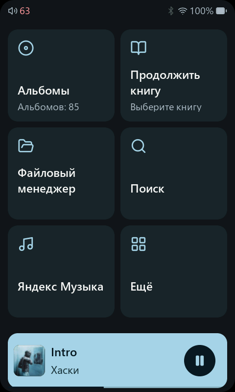
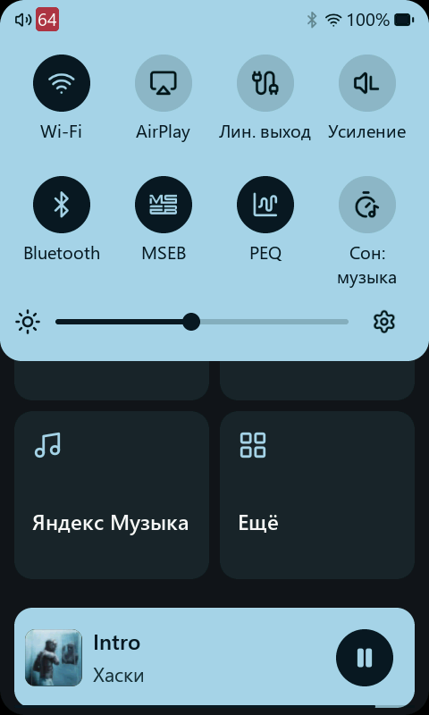
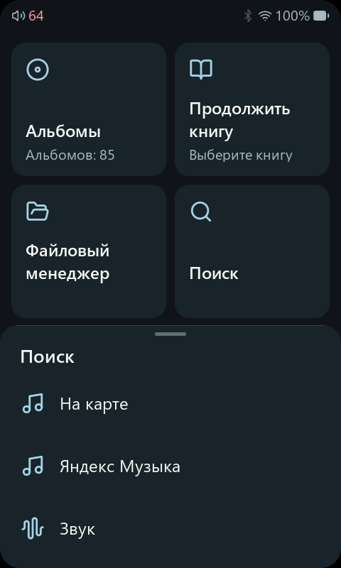
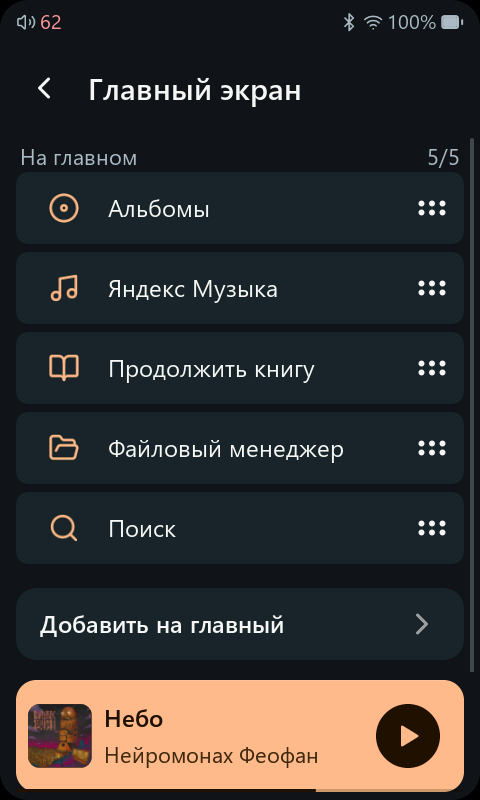
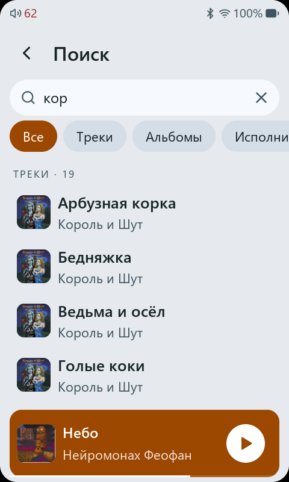
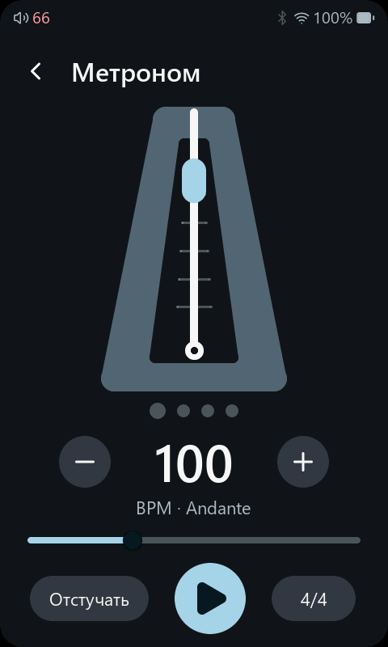
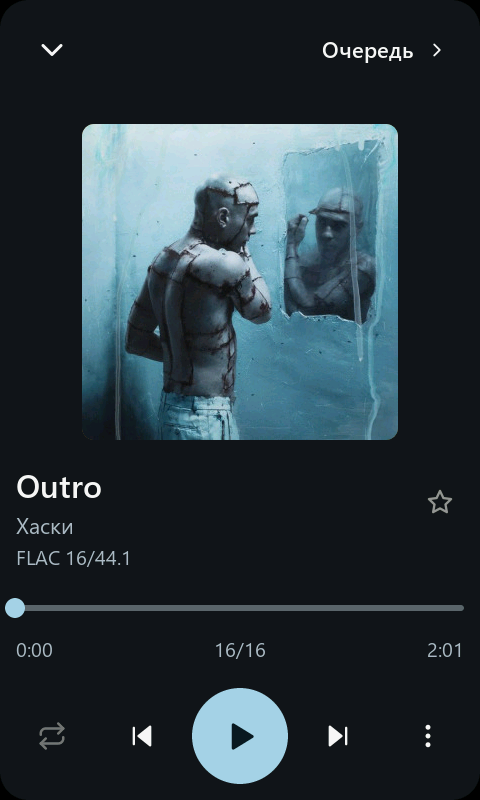
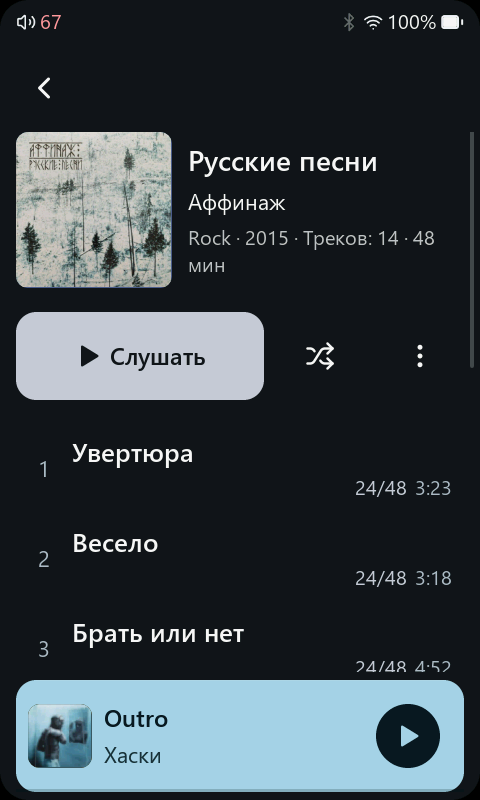

# Rekkod-mod · Sonix для HiBy R1

**Прошивка для HiBy R1: музыка с карты и из сервисов, аудиокниги в дороге и интерфейс «Графит 2».**

rekkod-mod развивает [Sonix Player](https://github.com/Jepl4r/sonix-player): добавляет Яндекс Музыку, Звук и собственные доработки управления, звука и работы с картой. Основная модель для разработки и проверки — **HiBy R1**.

[Страница проекта](http://46.17.44.217/sonix/) · [Возможности](#что-умеет-плеер) · [Жесты](#жесты) · [Что нового](#что-нового-в-142) · [Обновление](#сборки-и-обновление) · [Документация](#документация)

## Как это выглядит

Реальные снимки **HiBy R1**: настраиваемая главная, обновлённая шторка и выбор области поиска. Цвет акцента можно выбрать самому или брать из обложки.

<table>
<tr><th>Главная под себя</th><th>Быстрые настройки</th><th>Где искать</th></tr>
<tr>
<td></td>
<td></td>
<td></td>
</tr>
</table>

**Текущая подготовленная сборка — 1.4.2 · 27 октября 2026.** Для проверенного R1 с BCM-радиомодулем: база HiBy OS 2.0, «Графит 2», свежий PGO с реального R1 и LTO/O3. Итоговая программа проверена на устройстве; образ проверен отдельно. Опубликованные файлы — в [GitHub Releases](https://github.com/Rekkod-Tree/sonix-player-rekkod-mod/releases). [Результаты проверки 1.4.2](PERFORMANCE_B1_RESULT_2026-10-27.md).

**В повседневном использовании:** продолжить книгу одним нажатием, найти музыку среди подключённых источников, перемотать из мини-плеера и вернуться к открытому каталогу. Сохранённая на карту музыка доступна вдали от сети.

## Что умеет плеер

### Главная и управление

| Функция | Что это даёт |
| --- | --- |
| Пять своих ярлыков | Вынесите альбомы, исполнителей, избранное, файлы, поиск или нужный сервис. Порядок меняется в настройках главной. |
| Постоянная плитка «Ещё» | Убранные с главной разделы остаются доступны. Снятие ярлыка не удаляет музыку, аккаунты и настройки. |
| «Продолжить книгу» | Возвращает к последней прослушиваемой книге и её сохранённому месту, в том числе после музыки. |
| Меню по удержанию | Настройка плитки и действия с треком доступны рядом с выбранным элементом. |
| Мини-плеер | На главной — обычный с обложкой; на остальных страницах можно выбрать компактный. Есть перемотка с предпросмотром времени. |
| Светлое и тёмное оформление | Единые карточки, строки, иконки и настройки. Есть цветные акценты, нейтральный серый и окраска от обложки. |
| Быстрая шторка | Громкость, яркость, подключения, обработка звука и переход в настройки без долгого поиска по меню. |
| Общий таймер сна | Для музыки, сервисов, книг, подкастов и радио; смена источника не сбрасывает отсчёт, остаток виден в шторке. |

Прямые ярлыки **«Моя волна»** и **«Мне нравится»** доступны на главной и в меню удержания Яндекса. Возврат в действующую волну сохраняет очередь; замена другой музыки требует подтверждения.

### Музыка на карте

- **Библиотека:** треки, альбомы, исполнители, исполнители альбомов, жанры, годы и папки. Есть сортировки, избранное, недавно добавленная и недавно прослушанная музыка.
- **Поиск:** один запрос по карте и подключённым сервисам, категории результатов и история запросов. Медленный источник не задерживает остальные.
- **Плейлисты:** создание, переименование, выбор нескольких треков, импорт и экспорт M3U.
- **Очередь:** «Играть следующим» и «В конец очереди», удаление с отменой, перестановка предстоящих треков и история прослушивания.
- **Воспроизведение:** повтор трека или списка, перемешивание и непрерывное перемешивание; переход к следующему альбому или папке.
- **Обложки и теги:** названия, исполнители, длительность и качество записи. Для отсутствующих обложек — узнаваемые цветные заглушки.
- **Форматы:** FLAC, MP3, WAV, AAC/M4A, ALAC, Ogg Vorbis, Opus, WavPack, APE, AIFF, CAF, DSD и другие; поддерживаются CUE и главы в совместимых файлах.

### Стриминг и интернет-радио

| Источник | Возможности |
| --- | --- |
| **Яндекс Музыка** | Поиск, альбомы, исполнители, плейлисты, «Мне нравится», «Моя волна», выбор качества, сохранение треков и альбомов на карту. |
| **Звук** | Поиск, музыкальная коллекция, альбомы, плейлисты, сохранение музыки, аудиокниг и выпусков подкастов. Вход сейчас использует импорт токена аккаунта. |
| **Subsonic / OpenSubsonic** | Подключение своей музыкальной библиотеки, например Navidrome, и прослушивание с сервера. |
| **Tidal и Qobuz** | Каталоги сервисов, поиск, альбомы, плейлисты, избранное и настройки качества. |
| **Подкасты** | Поиск передач, подписки, загрузка выпусков, собственные RSS-ленты и импорт OPML. |
| **Интернет-радио** | Каталог станций, поиск, избранное, недавние станции и свой список в `radio.txt`. |

Для сервисов нужны соответствующие аккаунты и, где требуется, подписка. Доступность контента и способов входа зависит от сервиса и состава сборки.

В Яндекс Музыке и Звуке **сохранение текущего трека доступно прямо из меню полного плеера**. Сохранённую музыку можно слушать без сети. Названия в очереди подгружаются отдельно от аудиофайла, чтобы вместо песни не показывалось техническое имя загрузки.

### Аудиокниги и подкасты в дороге

- **Своя книжная полка:** книги, авторы, серии и продолжение начатого. Папку аудиокниг можно выбрать.
- **Прогресс и закладки:** позиция сохраняется отдельно для книги и переживает повторное сканирование библиотеки.
- **Главы:** встроенные главы и книги из нескольких файлов; отмечены текущая, дослушанные и ещё не прослушанные части.
- **Управление:** переходы на заданное число секунд и скорость 0,5–2× с сохранением высоты голоса.
- **Сон:** таймер и остановка на границе главы, где она доступна.
- **Офлайн-книги из Яндекса и Звука:** книга скачивается в раздел аудиокниг с правильным порядком частей. Незавершённая загрузка не выдаётся за готовую книгу.
- **Выпуски подкастов:** можно сохранять отдельно. Прогресс локального выпуска сохраняется; синхронизация позиции между стримингом и локальной копией пока не реализована.

### Звук под свои наушники

| Настройка | Возможности |
| --- | --- |
| **Обычный эквалайзер** | Десять полос, готовые и собственные пресеты. |
| **Параметрический EQ** | Десять полос с настройкой частоты, усиления, добротности и типа фильтра; график отклика и числовой ввод Gain/Q. |
| **Пресеты AutoEQ / Equalizer APO** | Поиск профиля наушников и импорт совместимых файлов из папки `PEQ`. Скачивание профиля само по себе не меняет активный звук. |
| **MSEB** | Настройка характера звучания: температура, бас, плотность, вокал, верхние частоты и другие параметры. |
| **Сцена и каналы** | Ширина стереобазы, баланс и crossfeed. |
| **Уровень и переходы** | ReplayGain, плавные переходы, gapless и раздельное запоминание громкости выходов и Bluetooth-наушников. |
| **ЦАП и DSD** | Доступные для модели фильтры ЦАП, настройки выхода и воспроизведение DSD через DoP или преобразование в PCM. |

Готовый профиль — отправная точка, а не универсальная гарантия хорошего звучания: модель наушников, посадка и ANC имеют значение. [Наши экспериментальные пресеты и результаты сравнений](AUDIO_PRESETS.md).

### Подключения

- **Bluetooth-наушники:** выбор доступного кодека, адаптивный LDAC ABR по умолчанию, настройки частоты и параметры пары. Плеер показывает качество записи и фактический Bluetooth-канал.
- **Bluetooth-приёмник:** слушайте на плеере звук с телефона или компьютера.
- **AirPlay и DLNA:** передавайте музыку на плеер по сети.
- **USB-ЦАП:** используйте плеер как звуковую карту или подключайте внешний USB-ЦАП и USB-наушники.
- **Wi-Fi-передача:** загружайте музыку и папки через браузер в одной сети, без вынимания карты.
- **USB-накопитель:** управляйте картой с компьютера; перед передачей плеер закрывает свои файлы.
- **SonixLink:** удалённое управление воспроизведением с совместимого клиента.

### Ещё полезное

- **Файловый менеджер:** прослушивание из папок, выбор нескольких файлов, копирование, перенос, удаление и выбор папки назначения.
Служебные файлы и папки в проводнике скрыты по умолчанию; их можно показать через меню.

- **Тексты песен:** просмотр LRC, поиск через LRCLIB и сохранение текста рядом с музыкой.
- **Читалка EPUB:** оглавление, изображения, закладки, размер текста и темы чтения.
- **Метроном:** настройка темпа, размера и отбивание темпа касанием.
- **Картинки и игры:** просмотр JPEG/PNG/GIF и Game Boy / Game Boy Color для собственных файлов игр.
- **Кнопки:** переназначение доступных действий и управление с совместимого проводного пульта.
- **Питание:** сон, автоматическое выключение, ограничение заряда и экран с процентом батареи при зарядке выключенного плеера — тоже в стиле Graphite 2.
- **Скриншоты:** сохранение изображения экрана на карту после включения функции в настройках.
- **Часы:** синхронизация времени по сети, настройка часового пояса и отображения часов.

<b>Ещё реальные кадры: настройка главной, книги, поиск и метроном</b>

Кадры аппаратного прогона и снимок пользователя. Здесь настоящая библиотека R1, без симулятора и подставных данных.

<table>
<tr><th>Порядок ярлыков</th><th>Продолжение книги</th></tr>
<tr>
<td></td>
<td></td>
</tr>
<tr><th>Поиск по библиотеке</th><th>Метроном</th></tr>
<tr>
<td></td>
<td></td>
</tr>
<tr><th>Полный плеер</th><th>Страница альбома</th></tr>
<tr>
<td></td>
<td></td>
</tr>
</table>

## Жесты

| Где | Действие | Результат |
| --- | --- | --- |
| Страница интерфейса | Свайп вправо от левого края | Назад на предыдущую страницу. |
| Список треков | Свайп по строке вправо | Играть выбранный трек следующим. |
| Список треков с поддержкой избранного | Свайп по строке влево | Добавить в избранное или убрать из него. |
| Предстоящие треки в очереди | Свайп влево | Удалить из очереди; действие можно отменить. |
| Трек, альбом, папка | Удержание | Меню доступных действий. |
| Плитка главной | Удержание | Меню ярлыка и настройка главного экрана. |
| Мини-плеер | Тап или свайп вверх | Открыть полный плеер. |
| Мини-плеер | Свайп влево / вправо | Следующий / предыдущий трек. Это другие действия, чем свайпы строки списка. |
| Верхний край | Потянуть вниз | Открыть шторку быстрых настроек. |
| Полный плеер | Потянуть вниз | Свернуть плеер и вернуться к открытой странице. |
| Нижняя область полного плеера | Свайп вверх | Перейти на главную, не прерывая музыку. |
| Редактор главной / предстоящая очередь | Перетаскивание за ручку | Изменить порядок элементов. |
| «Музыка» | Действие в меню раздела | Открыть карусель альбомов; вертикальная прокрутка остаётся прокруткой. |
| Мини-плеер | Удержать и вести горизонтально | Предпросмотр времени; отпустить для перемотки. Движение вверх отменяет её. |
| Полный плеер | Свайп от левого края | Вернуться к странице открытия, не меняя трек. |
| Краевой жест «Назад» | Удержать в конце | На главную; возврат пальца отменяет действие. |

Жест по строке начинается внутри строки, а «Назад» — от самого левого края. Набор действий зависит от содержимого: у папки, трека и очереди разные задачи. Кнопки и меню остаются доступны наряду с жестами.

В читалке EPUB двойное касание верхней части страницы добавляет закладку.

**[Посмотреть скринкаст с реального R1 — MP4](screenshots/demos/r1-graphite2-gestures-alpha19.mp4)** · [GIF](screenshots/demos/r1-graphite2-gestures-alpha19.gif) · [анимированный WebP](screenshots/demos/r1-graphite2-gestures-alpha19.webp).

Около 35 секунд: главная, удержание плитки, редактор, «Назад», шторка, полный плеер и действия по строке. Ролик смонтирован из настоящих кадров alpha19; подписи находятся под экраном. Свайп «следующим» показан как предпросмотр, без изменения очереди. Снимки и ролик не содержат симулятора или моковых данных.

## Что изменено относительно Sonix

| Откуда | Что входит |
| --- | --- |
| **Сохранено из Sonix** | Локальное воспроизведение, библиотека и плейлисты, аудиокниги, обработка звука, Bluetooth/USB, Tidal/Qobuz, радио, EPUB и другие базовые возможности. |
| **Собственные доработки rekkod-mod** | Graphite 2, настройка главной, Яндекс Музыка и Звук, OpenSubsonic, офлайн-сохранение, расширенные действия очереди, доработки Bluetooth, карты и поиска. |
| **Перенесено из Sonix 1.3 с адаптацией** | История прослушивания, действия очереди с отменой и перестановкой, RSS/OPML, FLAC-радио, LRCLIB, просмотр картинок, числовой ввод PEQ, метроном и улучшения чтения тегов и перемотки. |
| **Адаптировано под R1 и новый UI** | Шторка и громкость в общей палитре, альбомная страница, жесты, запуск и экран зарядки, согласованные настройки и сообщения об ошибках. |

Это не обещание побайтового совпадения с оригиналом: изменения переносятся с учётом нашего интерфейса, функций и ограничений R1. [Подробный перечень возможностей](FEATURES.md).

## Что нового в 1.4.2

- **Управление:** разделены краевой «Назад» и действия со строками; обложка следует за жестом, мини-плеер разворачивается под пальцем. Карусель открывается отдельным действием в меню.
- **История и книги:** запуск музыки после книги обновляет плеер; «Продолжить» сразу начинает прослушивание, а при отсутствии подходящей книги открывает библиотеку. История и очередь подписывают источник.
- **Поиск и каталог:** общий запрос делегируется подключённым сервисам; при вводе показаны недавние запросы. Раздел сохраняет последнее место просмотра в текущей сессии; к играющему источнику ведёт отдельное действие.
- **Bluetooth:** адаптивный LDAC ABR, фактический битрейт канала и сохранение позиции при сбое выхода. Это не обещание устранения любых радиопомех.
- **Отзывчивость:** ограничена работа очереди GUI, результаты файловых операций не теряются, частые записи истории и позиции объединяются. Обложки переиспользуются при движении.
- **Карта:** файловые операции удерживают владельца носителя. При ошибке запуска рабочего потока дисковая работа не выполняется в интерфейсе.
- **Сборка:** свежий PGO, LTO/O3 и строгие проверки ABI. Обучающих счётчиков в конечном образе нет.

[Полный справочник](FEATURES.md) · [Проверки и измерения](PERFORMANCE_B1_RESULT_2026-10-27.md) · [Изменения 1.4.1](RELEASE_1.4.1.md)

<b>Границы текущей проверки</b>

Подтверждены сценарии на реальном R1 и структура образа. Длительная автономность, все условия Bluetooth и причина редких перезапусков остаются отдельными проверками. Полная цепочка просмотра после перезапуска ещё не восстанавливается. Spotify в образ не включён; прогресс книг не синхронизируется с аккаунтами сервисов.

## Ориентиры проекта

- **Удобство на настоящем R1:** читаемые подписи, удобные зоны касания, последовательные жесты и единые компоненты.
- **Функции сохраняются:** обновление оформления не должно ломать очередь, прогресс книг, поиск и сервисы.
- **Нужное — нативно:** систему плагинов пока отложили; полезные возможности развиваем внутри прошивки.
- **Бережная работа с картой и батареей:** меньше ненужных записей, фоновых опросов и загрузок; исправления проверяются по сценариям, а цифры ускорения и автономности публикуются только по замерам.
- **Прозрачный статус:** готовые функции, текущие доработки и непроверенные случаи разделяются. Исследования и результаты хранятся в репозитории.

## Сборки и обновление

1. Выберите образ **именно для своей модели** и прочитайте описание конкретной сборки. Основной образ R1 называется `r1.upt`.
2. Скопируйте его в корень microSD и безопасно отключите карту или USB-накопитель от компьютера.
3. Запустите обновление с карты в системных настройках и дождитесь завершения.

[Раздел сборок GitHub](https://github.com/Rekkod-Tree/sonix-player-rekkod-mod/releases), если образы там опубликованы. Содержимое ветки `main` может опережать готовый образ; ориентируйтесь на описание полученной от автора сборки.

**Исправление recovery добровольное.** Обычное совместимое обновление не требует его предварительной замены. Отдельный мастер нужен для исправления известного поведения старого recovery при обращении с картой; он не запускается автоматически. [Подробности и ограничения](RECOVERY_R1.md).

Разработка и аппаратные проверки этой модификации сосредоточены на **HiBy R1**. Наличие поддержки R3 Pro II в исходном Sonix не означает, что каждый образ этого мода проверен на R3 Pro II.

## Документация

- [Alpha23: пути подкастов, тосты и результаты проверки](POINT_FIXES_2026-10-21.md).
- [Alpha22: точечные исправления надёжности и проверки](RELIABILITY_FIXES_2026-10-21.md).
- [Управление, аудиокниги и большие M3U](PLAYBACK_FEEDBACK_2026-10-21.md).
- [Alpha21: новая база, зависимости и границы проверки](ALPHA21_RELEASE.md).
- [Технические детали перехода на HiBy 2.0](STOCK2_MIGRATION.md).
- [Полный справочник возможностей](FEATURES.md).
- [Настраиваемая главная: изменения alpha19](ALPHA19_RELEASE.md).
- [Проверки и ограничения alpha18](ALPHA18_RELEASE.md).
- [Ранние изменения rekkod-mod](CHANGELOG-rekkod.md).
- [Исследования, замеры и решения](RESEARCH.md).
- [Пресеты звука](AUDIO_PRESETS.md).
- [Сборка и разработка](DEVELOPMENT.md) — технические инструкции вынесены отдельно.

## Авторство

Модификация — **Rekkod**, основа — **[Sonix Player](https://github.com/Jepl4r/sonix-player)** и работа сообщества HiBy. Лицензия исходного кода — [GPLv3](LICENSE).

Спасибо авторам Sonix, [Tartarus6](https://github.com/Tartarus6), [noisetta](https://github.com/noisetta), [endgame47](https://github.com/endgame47), [hkhrithik007](https://github.com/hkhrithik007) и участникам сообщества, которые помогают с разработкой и проверками.
