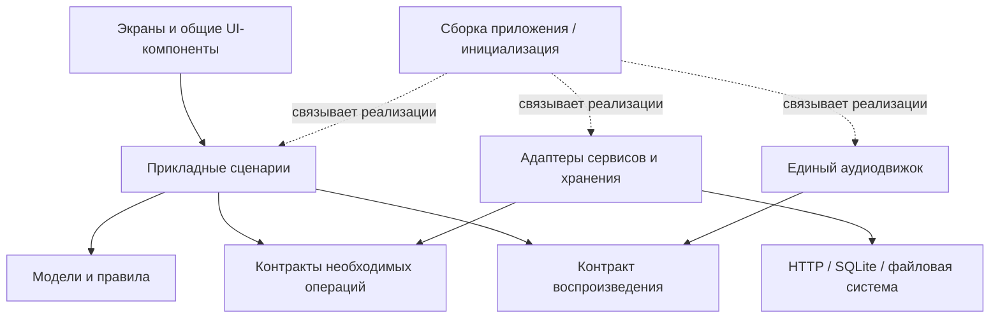

# Целевая архитектура Sonix rekkod-mod

Дата: 26.10.2026. Основание: рабочая ветка `fix/gesture-navigation`, база
`b3a5d0b`; просмотр действующих интерфейсов и сквозных сценариев. Это проект
поэтапного рефакторинга, а не заявление о завершённой перестройке прошивки.
Предыдущий план контроллеров: [архитектурный обзор](ARCHITECTURE_REVIEW_2026-10-20.md).
Порядок внедрения, ожидаемая польза и выбор состава сборки:
[план рефакторинга](REFACTORING_PLAN_2026-10-26.md).

## От чего отталкиваемся

Общие компоненты и объекты данных уже существуют. Их следует сохранить:

- `sx_card`, `sx_row`, `sx_sheet`, `sx_mini`, стили и токены — общие визуальные
  примитивы; `gridpage`, `svcui`, `svclist` — композиции экранов и списков.
- `device_state_t` — состояние воспроизведения; `playlist` — очередь и её
  фактический порядок; библиотечные индексы — экономное представление больших списков.
- `playhistory` — фактические прослушивания; `playbackplace_t` — подтверждённое
  место запуска; `switcher` — навигация; `audiobookdb` — книги и позиции.
- `stream_provider_t`, `search_source_t` — существующие реестры и таблицы
  операций. Провайдеры сохраняют собственные типы ответов и особенности API.
- Допуск записи на карту, поколения операций, ограниченная доставка событий,
  ленивые страницы и единый аудиотракт — действующие механизмы.

Основная задача — согласовать ответственность и взаимодействия этих частей,
убрать обходы контрактов и дублирующиеся решения. Сам по себе размер файла или
количество структур не доказывает архитектурный дефект.

## Что подтверждено сейчас

| Наблюдение | Архитектурная причина или граница |
|---|---|
| Во время книги «Музыка» подписана прежним местом «Файлы» | `main_menu.c:137` берёт последнее место просмотра. Оно правильно независимо от книги, но подпись не объясняла, что это назначение плитки. Потери музыкального контекста в проверенном сценарии нет. |
| «Продолжить» не даёт выбрать следующую книгу | `bookresume.c` отдельно собирает подпись и действие из INI, признака завершения, текущего аудио и checkpoint. Раньше ветви законченной/недоступной книги не давали общего понятного результата. |
| Непонятный прогресс книги | `yandexdl`/`zvukdl` сообщают процент файла; завершённая книга увеличивает `done` на одну операцию. Номера и количества глав в снимке нет. `downloadspage.c:71` дополнительно отбрасывает `done/failed`. |
| Из источника Back возвращал в плеер | История открытия экранов и родитель каталога имеют разный смысл. В новой рабочей правке переход к источнику начинает обычную иерархию каталога. |
| «Следующим» могло потеряться при смене режима | В `playlist.c` признак явного следующего был у добавленных путей, но отсутствовал у библиотечных элементов. Это несогласованность модели очереди; отдельный backend-тест воспроизвёл её. Исправление ещё требует полного набора проверок. |
| Системные модули импортируют интерфейс | Статический аудит нашёл 19 прямых include GUI в 14 системных файлах. Это не 19 багов: часть использует только доставку событий, `chargescreen` сам является представлением. Внешний движок Spotify не поставляется, но его C-клиент регистрируется; нельзя считать весь его код исключённым. Конкретная сильная связь: `system/device/usb.c:129` непосредственно обновляет файловый экран. |

Аудит include сохранён в `output/gesture-navigation-20261026/architecture/include-audit.json`
рабочей папки Mediateka. Он учитывает условно отключённые исходники и не является
доказательством циклов выполнения или замером производительности.

## Целевое разделение ответственности

Это логические слои. Создавать для каждого пустую директорию или немедленно
перемещать существующие файлы не требуется.

| Слой | Ответственность | Публичная граница |
|---|---|---|
| Компоненты UI | Геометрия, оформление, касания, состояния контролов | Существующие `sx_*`, `gridpage`, `svclist`; данные для отображения и события пользователя |
| Экраны и навигация | Собрать компоненты, показать снимок, выполнить навигационное намерение | Открытие/закрытие, якорь списка, преобразование команды пользователя |
| Прикладные сценарии | «Продолжить книгу», «Играть этот список», «Скачать книгу», сменить источник | Небольшие типизированные запросы, решения и результаты |
| Предметное состояние | Очередь, режим повтора, глава, позиция, история, состояние задания | Один владелец каждого состояния, инварианты и ревизии |
| Адаптеры сервисов и хранения | HTTP/API, авторизация, SQLite/INI, кэш и публикация файлов | Реализация нужных операций через существующие контракты |
| Платформа и аудио | PCM, декодеры/DSP, Bluetooth, питание, ввод, файловые дескрипторы | Протоколы платформы, аудиокоманды и фактические результаты |

Зависимости исходного кода направлены к контрактам и владельцам состояния:

Стрелки означают зависимости кода, а не передачу PCM. Реализации операций
подключаются при инициализации. Один сервис не вызывает экран другого;
общий сценарий работает через существующий реестр и объявленные возможности.
Согласование ресурсов выполняют общий арбитр стриминга, хранение и политика
питания, а не взаимные вызовы клиентов Яндекса и Звука.

### Композиция и интерфейсы в C

Для нашей прошивки основа — структуры данных, небольшие таблицы операций и
явные связи. Глубокая иерархия наследования здесь не нужна. Повторно используются
готовые компоненты, операции и алгоритмы; специализация сервиса остаётся в его адаптере.

Контракт должен обещать только то, что реализация может выполнить. Поиск,
воспроизведение, постоянная загрузка и работа с аккаунтом — разные возможности.
Их можно предоставлять отдельно по реальной необходимости. Подкасту не нужны
фиктивные операции музыкального избранного; неподдерживаемая операция возвращает
явный результат. Не следует превращать `stream_provider_t` в структуру со всеми
операциями всех экранов. Сначала переиспользуется существующий интерфейс; новый
выделяется при конкретном повторении или нарушении границы.

Общие типы содержат идентичность и необходимые поля. Ответ API, учётные данные,
LVGL-объект и полный каталог не становятся частью каждого общего объекта.
Универсальный объект со множеством несвязанных необязательных полей усложнит
проверки и повысит расход памяти.

## Контексты, которые должны оставаться разными

### Схема между объектами и представлениями

Для C/LVGL целевое направление — **MVP с явными снимками состояния**:
пассивное представление, небольшой presenter и прикладные сценарии. Это способ
распределения существующего кода; новые базовые классы, автоматический binding
или фреймворк для него не требуются.

Пунктир не означает импорт UI в модель. Подписку/доставку связывает
инициализация приложения. Изменение сообщает о необходимости перечитать снимок;
модель не вызывает конкретный экран. Закрытое представление не перерисовывается.

| Объект/владелец | Какие представления используют | Что не должно становиться второй копией истины |
|---|---|---|
| Сессия воспроизведения (`device_state` + существующий аудиодвижок) | Мини-плеер, полный плеер, информация о выходе | Собственные current track / playing / progress в каждом экране |
| Очередь (`playlist`) | Экран очереди, Next/Previous, индикатор порядка | Отдельный перемешанный список у экрана очереди |
| Каталог и его индекс | Треки, альбомы, артисты, поиск | Очередь не обязана повторять текущую сортировку просматриваемого каталога |
| Место просмотра | Плитка раздела, каталог, обычный Back | Текущая книга или подтверждённый источник запуска |
| Источник запуска очереди | Действие «К источнику воспроизведения» | Последний просмотренный альбом |
| Книга, checkpoint и выбранная книга | Полка, «Продолжить», главы, книжные элементы плеера | Собственные признаки finished/selected и позиции в каждой кнопке |
| Задание загрузки и локальная публикация | Краткий статус сервиса, экран загрузок, готовое скачанное | Разные счётчики прогресса, рассчитанные экранами из неодинаковых единиц |

Presenter хранит только состояние конкретного представления: видимые строки,
выбранный фильтр, состояние открытия/ожидания и ревизию принятого снимка. Он
форматирует заголовки и доступные действия, но не скачивает книгу, не сортирует
настоящую очередь и не определяет заново, завершена ли глава. В простой плитке
роль presenter может выполнять несколько функций существующего модуля.

Например, мини-плеер и полный плеер по-разному оформляют одну сессию; оба
посылают одну команду seek с абсолютной целевой позицией. Проверку seekable,
границ файла и действительности текущего трека выполняет общий сценарий.
Точно так же tap «Продолжить» и действие из удержания используют одно решение
о продолжении, хотя выглядят по-разному.

У общих компонентов есть параметры оформления и отображаемые данные. Они
выдают события с устойчивой идентичностью и ревизией привязки. Это особенно
важно для переиспользуемых строк: сохранённый номер виджета не равен ID трека.
SQL, авторизация и правила очереди не становятся обязанностями `sx_row`.

Экран не открывает соседний экран, чтобы получить принадлежащие ему данные.
Данные запрашиваются у владельца через прикладной API; переход оформляется
навигационным намерением. Временный снимок UI можно удалить и восстановить без
потери воспроизведения, очереди, задания загрузки или книжного прогресса.

| Контекст | Владелец истины | Правило обновления |
|---|---|---|
| Что играет | `device_state`, аудиодвижок и очередь | Подтверждённая смена/состояние воспроизведения |
| Где пользователь смотрел каталог | Навигация и текущая страница каталога | Переходы, фильтр, сортировка, якорь прокрутки |
| Откуда запустили текущую очередь | `playbackplace` и идентичность источника очереди | Успешный запуск; простое листание не заменяет origin |
| Какую книгу продолжать | Выбранная книга и её состояние в `audiobookdb` | Фактический запуск книги; завершение меняет допустимое действие |
| Что слушали раньше | `playhistory` | Подтверждённое прослушивание; пауза и seek не создают новый запуск |
| Что скачивается и готово | Загрузочный worker и локальная публикация | События операции и проверка завершённой публикации |

Для согласованного поведения нужен общий **результат решения**, а не одна
глобальная переменная «текущий контент». Например, решение о продолжении содержит
книгу и исход: можно попытаться продолжить / выбрать книгу / закончена /
недоступна. Подпись и команда используют одну семантику. Существование физического
файла окончательно проверяется при выполнении команды; отрисовка не сканирует карту.

Аналогично плитка получает назначение и подпись из одного решения: «Вернуться:
Файлы» означает открыть прежний каталог. «К источнику воспроизведения» — отдельное
намерение. `Back`, «выше в каталоге», «на главную» и «открыть плеер» не должны
подменять друг друга одной универсальной историей экранов.

Идентичность контента, место файла и каталог запуска различаются. Сохранённая
из сервиса книга находится на карте, но это не превращает её в музыкальный альбом.
Источник офлайн-файла нельзя угадывать по цвету, заголовку или расширению.

## Контракты выполнения и времени жизни

- Прикладное состояние очереди сохраняет одного владельца. Это может быть тот
  же основной поток, где работает LVGL: отдельный поток сценариев не требуется.
- Экран передаёт ограниченный запрос с идентификаторами; работник не получает
  указатели на виджеты или изменяемую очередь. Снимок имеет ревизию и владельца памяти.
- Принятие команды, завершение сетевого запроса и начало фактического звука —
  разные результаты. Ошибка, отмена, устаревшее поколение и отсутствие возможности
  не маскируются общим `false` там, где пользователь должен действовать по-разному.
- Сетевое/дисковое ожидание выполняется существующими работниками. Основной и
  аудиопоток не ждут HTTP, обхода каталогов или окончания чужого worker под mutex.
- Изменившаяся карта, запрос, сессия или очередь отменяют право старой операции
  применять результат. Токен допуска карты и pin проверяются на границе записи;
  совпадение строки пути не заменяет проверку поколения и настоящего каталога.
- Готовность загрузки означает успешную публикацию целого результата. Снимок
  книги содержит фазу, номер/количество частей, завершённые части и процент
  текущего файла. Ошибки и готовые книги считаются в своих единицах.
- Состояние важного завершения хранится у владельца до обработки; всплывающее
  уведомление — лишь представление. При переполнении очереди событий память
  освобождается по контракту, состояние не объявляется успешно обработанным.
- Открытие/закрытие страницы управляет её отображением. Воспроизведение и
  загрузочное задание живут по своему сценарию; закрытие страницы само по себе
  не уничтожает их очередь или прогресс.

## Как сделать поддержку прозрачнее

1. В заголовке модуля кратко фиксировать ответственность, владельца состояния,
   разрешённый поток, время жизни данных и поведение отмены. Эти правила относятся
   к API, а не прячутся только в большом обзорном документе.
2. Публичный API содержит нужные соседям операции. Рабочие структуры, SQL,
   HTTP-поля и LVGL-виджеты остаются приватными. Удалённый клиент и экран вызывают
   один прикладной сценарий, сохраняя одинаковые проверки.
3. Новые межслойные зависимости проверять автоматически по include и небольшому
   списку допустимых границ. Старые исключения перечислить с причиной; новые
   обратные импорты требуют явного решения. Счётчик include не заменяет ревью.
4. Диагностика связывает запрос, источник, поколение и терминальный результат.
   Логировать переходы и ошибки ограниченно, без секретов и непрерывной записи
   прогресса на карту. По одному идентификатору должна прослеживаться операция.
5. Тестировать сценарий через публичный контракт и адаптер, затем через общий
   интерфейс: реальные очередь/SQLite/работники там, где ошибка относится к ним.
   Сервисные различия проверяются контрактными тестами, а не копиями экранов.
6. Порядок файлов сохранять понятным по владельцу функции. Физическое перемещение
   и переименование выполнять вместе с переносом ответственности, а не отдельной
   большой волной ради новой структуры директорий.

## Практический порядок перехода

1. Закончить текущие UX-исправления и их регрессии. Выделить небольшое общее решение
   о продолжении книги внутри существующего модуля; затем убрать повторное
   вычисление в представлениях. Сохранить INI/SQLite и текущую выбранную книгу.
2. Дополнить контракт задания загрузки, адаптировать Яндекс/Звук и существующую
   страницу загрузок. Терминальный итог ограничен по размеру; скачанное отделено
   от временного кэша. Новая страница не должна исправлять отсутствие данных догадками.
3. По существующему плану #20–23 перенести orchestration одного из
   Qobuz/Tidal/Subsonic из page-модуля в контроллер по образцу `yandexplay`/
   `zvukplay`. Проверить работу при ещё не построенной странице, затем остальные
   сервисы по одному. Действующие контракты и служебные адаптеры сохраняются.
4. Отделить нейтральный контракт доставки из `gui.h`, сохранив ограниченную
   очередь, `eventfd`, правила владения и резервные завершения. Системные события
   вроде возврата карты принимает UI-адаптер; USB не знает конкретный файловый экран.
   Презентационный экран зарядки учитывать как UI-адаптер независимо от его папки.
5. Удалять прежние пути после функционального паритета. Затем переснимать
   dependency-граф, размеры, память, idle и задержки. Решение об обучении PGO
   принимать для принятого состава сборки отдельно.

Старое предложение о массовом переносе контроллеров остаётся предложением.
Этот анализ не означает разрешение сразу менять все сервисы, потоки, форматы
или аудиодвижок.

## Что получим и чем это доказывать

| Ожидаемый результат | Механизм | Проверка |
|---|---|---|
| Подписи и действия согласованы | Общие решения поверх раздельных контекстов | Книга → музыка → главная → источник/просмотр; completed/missing/empty |
| Изменение сервиса затрагивает меньше мест | Адаптеры и явные возможности | Добавить/отключить один адаптер; поиск/каталог/очередь используют те же контракты |
| Меньше гонок и обращений к мёртвым экранам | Владение, поколения, приватные workers | Задержанный ответ после Back/logout/смены карты/замены очереди |
| Предсказуемые ресурсы | Ограниченные данные, ленивые представления, жизненный цикл заданий | Плато RSS/FD после повторных открытий, отсутствие лишних idle-пробуждений |
| Проще локализовать дефект | Прослеживаемая команда, структурированный результат | По диагностике отличить отказ сети, хранения, отмену и ошибку отображения |
| Ниже риск следующих изменений | Автоматические границы и контрактные сценарии | Host/target/ABI и затем R1 на тех же сценариях; совместимость сохранённых данных |

Ускорение, уменьшение ELF и экономия батареи возможны после удаления дублирования
и лишней активности, но проценты заранее не обещаются. Число абстракций не является
показателем качества. Новый контракт должен уменьшать неоднозначность или
повторение и иметь проверяемую стоимость на нашем MIPS-устройстве.

## Фактическая проверка на этом срезе

Новые подпись назначения «Музыки» и fallback «Продолжить» прошли полный LVGL
host-сценарий на 480×800 и 480×720: `ux-book-return-r2/result.json` и
`home-empty-continue-r2/result.json` в `output/gesture-navigation-20261026`.
Проверены сохранение музыкального origin и каталога при книге, продолжение
незаконченной книги, законченная/пустая выбранная книга и недоступный файл.
Две ранние ошибки были в тестах: подготовка папки не открывала её экран;
старый Home-тест ожидал прежний способ открытия поиска. Негативные логи сохранены.

Целевая архитектура целиком не реализована и не измерена на R1. Системные
перезапуски, акустика Bluetooth и автономность этими UI-тестами не закрываются.
Плеер пользователя в этой волне не использовался.
